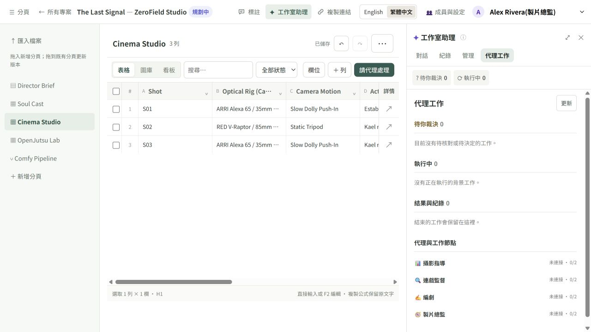

# ZeroField Studio

An open-source production workspace for planning films with a crew of AI agents. Organize a director brief, cast references, shot slates, and editable pipelines in one place.

Built for the ComfyUI [Open Source Higgsfield Challenge](https://comfy.org/open-source-higgsfield). The target is an open-weights filmmaking and V2V studio; this checkout delivers a **bilingual production workspace with inline video review, configurable Comfy workflows and a planning crew that runs on a local open-weights model**. The crew and provider work of [SPEC_20](docs/specs/SPEC_20_PLANNING_AGENT_LAYER_AND_PROVIDER_PRINCIPLES.md) is implemented and has had a first run on a real GPU with the local model; that run found open break points in the new-production path: see [Verification status of the SPEC_20 work](#verification-status-of-the-spec_20-work).

## Available now

- English / Traditional Chinese studio navigation, crew settings, annotations, asset review, and agent controls. English is the first-run default.
- The [Story Workbench](docs/STORY_WORKBENCH.md): five navigation entries, script confirmation/breakdown, scene-grouped galleries, wardrobe variants, candidate selection, card/node overrides, split/merge, batch generation and episode film export over `/aivideo/open/v1`.
- Three creative spaces on productions that have a cinema slate, behind one breadcrumb menu (Ctrl 1 / 2 / 3) with a scene · shot focus that travels between them and floating panels you can hide: **Story & World** (the writing workspace: the script with its stable outline, creative versions and the shots an edit would leave out of step; and the Cast & sets wall), **Shot Stage** (crew proposals reviewed on their shot, a draggable 3D plan with a beat track and easing curve, stored on the server with a revision number), and **Timeline** (frame-accurate per-shot trims with ripple or roll, a cut preview, and a film export that honors the trims). Built on a small control kit (parameter rows, range sliders, timecode fields, curve editor). Gaps are listed in [SPEC_15 §6](docs/specs/SPEC_15_UNIFIED_CREATIVE_WORKSPACE_UI_DESIGN.md): no write-back from shots to script lines, no audio tracks or J/L cuts, no razor, and the Timeline's "runs long" hints are a local rule, not an agent.
- SPEC_18 refinements inside those spaces: on the Cast & sets wall pictures generate in the background (several at once, each with cancel and retry, picked up again after a reload) and the card you pick opens in a large editor laid out like RunningHub's character editor (the picture beside all of its pictures, a strip of looks with a + for another one, the description as the biggest box, and one row of generation choices that shows the time earlier runs took or "time unknown"; voice, status and notes fold into a More section); the primary button opens a build/update dialog with per-mode shot estimates; Shot Stage detail shows the previs → first frame → video ladder and each shot's cast, whose look menus rewrite only the `@code` in the prompt. A production can also start from a story: the New Production dialog takes an idea, a novel chapter or a screenplay in one box, with a ratio and a style, and opens Story & World with it in the writing workspace (an idea or novel as a private source, a screenplay as the working script when empty, or a private draft rather than overwriting occupied content). Not built: character three-views, voice audio, and a generation line on shot detail ([SPEC_18 §11](docs/specs/SPEC_18_RUNNINGHUB_INFORMED_STUDIO_REVISION.md)).
- [SPEC_19](docs/specs/SPEC_19_SHOT_COMPOSER_ADOPTION_AND_FILM_PANEL.md) adoption and the film panel on the Shot Stage: a picked shot opens in a **composer** (the current take on top; **Reference** and **Camera** buttons open an example wall in its place, camera body, lens and aperture write `Optical Rig`, camera moves go into the prompt as `#tags` expanded in place; the prompt is the largest input, with inline `@` asset, `#` move and `@SC01-S02.end` cross-shot tags, a read-only view of the exact compiled prompt, and one row for output, workflow, seconds, 1–4 takes and the estimate). One ✓ (or `A`) adopts a take, story candidate or pending pipeline proposal, writing the media and Approved in one table edit; later takes never overwrite an adopted shot. The right column shows the shot in the cut: neighbours, a progress bar with seam dots, the takes, trim, the references it quoted and "upstream changed". A cut check sets the outgoing and incoming frames side by side for the Continuity Supervisor, queued behind renders. The film window counts adopted shots, fills gaps with the latest take, previs or nothing, can play only the seams, lets you try a take in the cut without writing anything, and exports `selection: "adopted"` with each segment's take, in/out points, references and cut result. Film setup (genre, image era, tempo), palette and lighting are three more buttons with their own walls; the episode sets defaults on an **Episode look** page (opened from the ratio and style tile in Story & World) and a shot can override any of them (本集 / 本鏡 on the button, Back to episode clears it). They compile into `Film:`, `Color:` (with the palette's hex codes) and `Lighting:` lines, the same text on the Story API and the M8 pipeline ([receipt](docs/spec19-verification.json)). Every look and camera option has a sample: FLUX 3 Klein stills of one original test scene and camera-move loops rendered by the 3D Stage, each with its seed, prompt and licence in `ui/public/assets/look-samples/manifest.json`. Not yet: OpenJutsu in the composer; no crew tool proposes a look yet; the M8 pipeline path does not resolve cross-shot references; cut checks and generation were exercised with stand-in models only.
- The [writing workspace](docs/WRITING_WORKSPACE.md) (SPEC_16) adds recoverable private sources/drafts, scene/plot editing, immutable creative versions, compare/adopt, selected-shot story impact, shared narrative notes, safe literal replacement and TXT/MD/DOCX / browser-print handoff. Saving text never generates media. In the three-space studio it is the editing face of Story & World's By scene view ([SPEC_16A](docs/specs/SPEC_16A_INTEGRATION_INTO_THREE_SPACE_STORY_WORLD.md)).
- Seventeen built-in Studio Cards (ten existing plus seven official native Router models) and authenticated persistent ComfyUI JSON / RunningHub curl imports. [Router protocol and limits](docs/COMFY_ROUTER.md) are separate from workflow-graph execution.
- The [lean Agent Console](docs/SPEC08_CONSOLE.md): exactly twelve functional pages, twelve templates/blank/literal drafts, seven governed Studio/advisor tools, versioned skills/scoped memory, isolated outcome grader, existing M8 sessions and manual/cron deployments, provider/environment references and combined truthful analytics/active limits. Independent review is pending; fixture engineering proof is not semantic-quality or billing acceptance.
- **Crew planning jobs** ([SPEC_20](docs/specs/SPEC_20_PLANNING_AGENT_LAYER_AND_PROVIDER_PRINCIPLES.md)). With a model ready, built-in crew roles write proposals where rules and templates used to decide alone. The Cinematographer writes a timed beat sheet into a shot's Action & Audio Prompt, picks its camera and lens (a ghost camera appears on the 3D Stage); Art (it runs on the Screenwriter's profile) writes locked appearance descriptions and new looks and works out who is in each shot or scene; the Screenwriter offers adaptation and shot-breakdown candidates in the script view, each with its storyboard impact beside the always-listed rule version. Every job has a JSON schema, a validator in code, at most one retry and a rule fallback (marked `rule_fallback`). The output is always a proposal: a single-cell table proposal locks only its target cells, so several can wait on one page, and nothing is written until a crew member adopts one. The crew never submits paid or closed generation. With no usable model a request answers 409 `DRAMA_CREW_NOT_READY` and writes nothing. Ask from the shot detail (**Ask the crew**), the Story & World asset card or the script view; jobs appear on the Agent Board with a cancel button, under a readiness banner that names what blocks the crew (worker off, Ollama unreachable, model not pulled, policy or price limits) and how to fix it. Code: [`crew_jobs.py`](project_assistant/crew_jobs.py), [`story_crew.py`](project_docs/story_crew.py). A pre-production flow chains the roles (Screenwriter, Art, Cinematographer, Continuity) with a human lock between stages (script, list, storyboard), starts from a "let the crew pre-produce" card once a storyboard is built, and runs the continuity check as a job.
- **3D plans the crew can edit.** The Stage's per-shot plan is stored on the server with a revision (a stale save is refused with 409 `DRAMA_PREVIS_REVISION_CONFLICT`, and the Stage offers reload or overwrite) and names its cast by `@CAST` code; a Stage button writes the plan's lens and camera motion back into the slate's Optical Rig and Camera Motion cells. The `propose_previs_ops` tool takes structured operations (`place`, `camera`, `retime`; at most 32) and a deterministic solver turns them into a plan, never code written by a model. The solver is the Stage's own JavaScript (`ui/src/previs/ops.js`), run on the server in a headless Edge or Chromium on SwiftShader (CPU, no network), which also renders a six-frame contact sheet for the proposal; set `ZEROFIELD_PREVIS_BROWSER` to pick another browser or `off` ([worker setup](docs/WORKERS.md)). With no browser the proposal keeps only the operations, the Stage solves them when you review, and a proposal without a solution cannot be approved. Such plan and camera proposals are `shot_meta` proposals reviewed on the 3D Stage, not in a table. Not built: a server-rendered WebM preview (the contact sheet only).
- **Provider tiers, failures and the GPU.** Agent models are sorted by `project_assistant/provider_catalog.json` into `local_open`, `hosted_open` and `closed`: `open_weights_only` allows only the first, hosted open weights also need a showrunner's switch (off by default), closed models need `hybrid_studio`, and `OPENBENCH_PRODUCTION_POLICY` caps the agent models as it caps media. The ledger records the model that actually answered; failures are classed (local, quota, auth, provider, timeout, empty, output, GPU busy) and shown in plain words. A failed call no longer locks the crew: local failures settle at once, a call whose result is unknown keeps its slot for 600 seconds by default and a showrunner can reconcile it in the Agent Console. Continuity grading and the Quickstart builder run under the same governance, and a cross-process GPU arbiter (a PostgreSQL advisory lock per GPU host) serializes ComfyUI renders, grading and local model calls ([worker setup](docs/WORKERS.md)). The ChatGPT subscription endpoint was removed.
- **Agent Console operations** (SPEC_20 R36 to R41). On Providers & API Keys, a model setup check tries the configured model with a chat, a tool call, a JSON-schema reply and an image, confirms it exists and shows its context length, and **Roles and models** lists what each role may use with its tier and holds the hosted-open-weights switch. The Dashboard has an automation switch (it holds automatic grading, crew pre-production jobs and scheduled deployments; work you start by hand still runs), a GPU panel (video memory, ComfyUI queue, loaded models) and a queue panel (chats, dispatches, worker failures and uncertain reservations of the production, with reconcile). Environments & Bridges has the External agents section described below.
- **Workflow manuals and evaluation.** [`skills/`](skills/README.md) holds four step-by-step manuals (crew pre-production, shot beats, 3D blocking, continuity check) that the `get_workflow` tool returns; the tools enforce scope, review and spending limits whether or not a manual is followed. An offline tool-surface audit (`python -X utf8 scripts/audit_tool_surface.py`) lists every tool the built-in crew, MCP and ACP can see and fails on any change to the checked-in list. A crew evaluation set ([`research/crew_eval/`](research/crew_eval/README.md), `scripts/crew_eval.py`) has eight hard cases each for beats, blocking and continuity, with reference answers and a scorer; the tests check that the reference answers score 100%. Against local `qwen3.8:27b` (2026-10-27) the beats set scored 18.56% and the continuity set 24.29% (2 of 8 cases each passed every hard check); the blocking set has no crew job to run yet.
- [SPEC_07 routing and allocation](docs/SPEC07_STUDIO_ROUTING.md): default open-weights policy lock, explicitly authorized hybrid graphless providers, source-bound batch allocation, real structural preparation and reviewed M8 media races/two-stage handoffs. Resource estimates are uncalibrated, not savings or quality promises.
- A `ZeroField Studio` template with five editable pages: **Director Brief**, **Soul Cast**, **Cinema Studio**, **OpenJutsu Lab**, and **Comfy Pipeline**.
- **The Last Signal** showcase, seeded by the launcher with original procedural PNG/MP4 playback fixtures, review statuses and a director annotation. Raw project templates retain empty media cells.
- Inline video controls and hover previews, cached metadata, candidate video comparison, and visual input/output chains with resolved `@Asset` references.
- Single-shot comparison, keyboard shot stepping and optical/motion/mode presets alongside Studio Assistant; selected shots and individual stages run in the current sheet.
- Standard reference packs: source video, extracted PNG frame, continuous motion guide, anchor keyframe, multiple `@Asset` images, prompt and seed.
- FFmpeg first-frame extraction, edge/luminance/frame-difference motion guides, and split-screen output with audio and faststart.
- OpenJutsu **Object Swap** rows: a FLUX 3 Klein swap key, then one LTX-2.5 graph that runs the Alpha-Gen IC-LoRA matte, regenerates the subject and composites it over the source ([workflow](workflows/README.md#openjutsu-subject-replacement-object-swap)).
- Cinema **Layout Render** from the 3D Stage: the previs and its actor matte drive the LTX-2.5 Layout-To-Render IC-LoRA after a reviewed FLUX 3 Klein key of frame 0, keeping the blocked set and camera ([workflow](workflows/README.md#layout-render-3d-stage-previs-as-an-ic-lora-layout), [S03 in the app](docs/verification/motion-lab/app_layout_lane_s03.jpg)).
- **Camera fidelity** in shot review: every video take in a row with a Previs is scored in the background against it (Lucas-Kanade + RANSAC camera path), with tilt / pan / zoom travel as a fraction of the previs move; needs `.[fidelity]` (OpenCV, NumPy) ([S03](docs/verification/camera-fidelity/s03_shot_review.png)).
- **Continuity grades** in shot review: the Continuity Supervisor's vision model grades a take's 8-frame contact sheet (score, issues, notes), optionally for every take as it lands. Grading waits for running ComfyUI renders and frees ComfyUI's models; the vision model stays loaded for further model calls and is unloaded (`keep_alive: 0`) before the next render; grades are information only: a failing grade carries a rewritten prompt, and **Retake with this prompt** writes it into the shot and re-renders in one click ([verification](docs/PHASE2_PROGRESS.md#continuity-grades-in-the-product)).
- Arbitrary external ComfyUI JSON slot binding through `input_bindings`, including dot paths and optional media; local ComfyUI or official Comfy SDK execution with separate Cinema and V2V worker routing.
- Documents, typed tables, gallery and board views, source-file import/export, revisions, and scoped editing proposals.
- The inherited M8 agent system: configurable roles and tools, persistent tasks and dispatches, decision gates, candidate comparison, batch row assignments, and the ACP stdio bridge.
- English statuses with compatibility for existing Chinese status values and legacy tool actions.

The default crew agents are Showrunner, Screenwriter, Cinematographer, and Continuity Supervisor. Candidate proposals are applied only after review. Existing authentication, permissions, stable row/column identities, and lease protections remain in place.

Use **English / 繁體中文** in the top bar to switch the interface. The same preference applies to sign-in and access-error pages and survives a reload. Switching preserves unsaved table / assistant drafts and does not translate or rewrite project titles, documents, prompts, custom agent names, or saved workflow definitions. The studio template and its example content remain English.



Translations live in `ui/src/i18n/locales/en.json` and `zh-TW.json`. Add semantic keys to both dictionaries, including matching interpolation parameters. Use fixed IDs and `normalizeStatus()` for application logic; use `statusLabel()` only for display. Legacy Chinese status values and tool action keys remain valid. API errors retain their original `error` and policy `code`, with additive `message_key` / `message_params` for localized presentation; unknown errors retain a readable fallback.

## Generation setup and limits

The bundled [FLUX 3 Klein and LTX 2.5 workflows](workflows/README.md) use open-weights model graphs and documented node dependencies. Install the listed weights/custom nodes in your Comfy deployment before generating. The official Comfy SDK remains the workflow-capable Developer Platform route. The separate official native Router model driver cannot execute arbitrary workflow graphs. It uses **POST `/estimate`**, not `/price`; even exact estimates are not price locks. Hard is the default and refuses unlocked charges. Only explicit versioned current-admin estimate-soft consent permits estimate-risk admission; overages remain visible, and provider reports are not invoices. Open-only stays local by default; hosted Router also needs explicitly authorized hybrid, current environment/credential grants and a fresh exact-input-bound quote.

Model quality has not been benchmarked. OpenJutsu provides source-guided V2V restyling with a reference image. Rows whose **Jutsu Mode** is `Object Swap` use an LTX-native subject replacement instead: the Alpha-Gen IC-LoRA mattes the subject, LTX-2.5 regenerates it from the FLUX 3 Klein edited first frame, and the result is composited inside the grown, feathered matte over the untouched source pixels, keeping the source audio. [Two RTX 4090 renders](docs/verification/openjutsu-swap/README.md) ran it, one through a lab driver and one through the Comfy SDK and comfy-api-proxy. Limits: Alpha-Gen mattes the whole foreground, so a shot with several people cannot pick one; clips are capped at 145 frames; higher denoise follows the new identity more closely but follows the source motion less (at 0.85 a held prop can disappear); the background inside the matte is regenerated too and drifts from the source at higher denoise (seams show at 0.9). The Clean-Plate IC-LoRA and depth conditioning are not wired. The bundled [showcase media](samples/README.md) are original CC0 procedural playback fixtures, not model renders or proof of motion/object transfer. `luma_depth` is a luminance structure proxy, not learned depth estimation. The sample V2V graph exposes a motion-guide upload slot; using that guide as model conditioning requires an externally authored compatible control graph.

## Run locally

Requirements: Python 3.11+, Node.js 22+ for frontend development, and PostgreSQL. The optional `embedded` extra supplies local PostgreSQL support; an installed PostgreSQL distribution can also be selected with `OPENBENCH_PG_BIN`.

```powershell
python -m venv .venv
.venv\Scripts\Activate.ps1
python -m pip install -e ".[embedded]"
npm ci --prefix ui
npm run build --prefix ui
python run_studio.py --port 3020 --no-worker
```

Open [http://127.0.0.1:3020/projects/](http://127.0.0.1:3020/projects/). The launcher seeds the default development showcase and crew and fills only empty showcase media cells once. Without `--no-worker` it also registers one set of local media workers that serves every production on this server; new productions get a Comfy Pipeline bound to them. Subsequent launches preserve edits and custom pipeline definitions. Existing productions are preserved. Development mode binds to the local machine and includes a crew identity switcher. This command is browse only (`--no-worker`); [Models](#models) shows how to turn the crew on.

For local generation, install the models/nodes listed in [workflow setup](workflows/README.md), then run:

```powershell
python run_studio.py --port 3020 --comfy-url http://127.0.0.1:8188
```

For the Comfy Developer Platform, install `.[comfy]` (the official `comfy-sdk` and `comfy-api-proxy`) and select `--platform comfy_sdk`. On your own GPU, run `comfy-api-proxy` next to ComfyUI: it serves the SDK's v2 API on `http://127.0.0.1:8189` in front of ComfyUI on `8188`, and that is the default endpoint when no `COMFY_API_KEY` is set. With a key the SDK targets Comfy Cloud; `--comfy-url` / `COMFY_BASE_URL` selects any other deployment.

```powershell
python -m pip install -e ".[comfy]"
comfy-api-proxy
python run_studio.py --port 3020 --platform comfy_sdk
```

Generation outputs are proposals for director review. The launcher uses `OPENBENCH_DB_URI` or `DATABASE_URL` when supplied, otherwise it starts the embedded development database (port 55432, or the next free port when that one is taken; `OPENBENCH_PG_PORT` pins it). `OPENBENCH_PG_BIN` selects an installed PostgreSQL bin directory. Non-development authentication never seeds demo accounts; unless `--no-worker` is given, it registers the same local media workers as development mode.

`--no-worker` is browse only: it registers and starts no workers, so nothing calls a model. To use the crew, set up a model as described in [Models](#models) and start without that flag. Existing `OPENBENCH_*` environment variables and CLI entry points are retained for compatibility.

## Models

The crew (Showrunner, Screenwriter, Cinematographer, Continuity Supervisor) uses a language model for chat, proposed edits and continuity grading; media generation runs on the Comfy workflows above. By default that model is local open weights: [Ollama](https://ollama.com) serving `qwen3.8:27b` at `http://127.0.0.1:11434/v1`. No `OPENBENCH_*` variable is needed.

1. Install Ollama, then pull the model (about 17 GB):

   ```powershell
   ollama pull qwen3.8:27b
   ```

2. Start Ollama with a larger context. On GPUs with less than 24 GiB of VRAM, Ollama's default context is 4k tokens ([Ollama docs](https://docs.ollama.com/context-length)), which can truncate the crew's longer prompts. If the Ollama app is already running, quit it first (or raise the context length in its settings). Then start the server with at least 16384:

   ```powershell
   $env:OLLAMA_CONTEXT_LENGTH=16384; ollama serve
   ```

   ```bash
   OLLAMA_CONTEXT_LENGTH=16384 ollama serve
   ```

   A larger context needs more VRAM. `ollama ps` shows the context in use and whether the model runs fully on the GPU.

   `ollama serve` reads its model folder from `OLLAMA_MODELS`, not from the Ollama app's settings. If you changed the model location in the app (or `OLLAMA_MODELS` points somewhere else), set `OLLAMA_MODELS` to the folder that holds `qwen3.8:27b` before `ollama serve`; otherwise the Agent Board reports the model as missing.

3. Start the studio without `--no-worker`:

   ```powershell
   python run_studio.py --port 3020
   ```

If the crew cannot work (the background worker is off, Ollama is unreachable, or the model has not been pulled), the Agent Board lists what is missing and how to fix it.

The default and the contest demo path use local open weights only. To use a different local server that speaks the OpenAI chat-completions protocol (vLLM, llama.cpp server, LM Studio), set `OPENBENCH_API_BASE` (the base URL including `/v1`) and `OPENBENCH_MODEL`. The default sends `reasoning_effort: medium` only for the complete local default; with a custom endpoint or model none is sent unless you set `OPENBENCH_REASONING_EFFORT` to `low`, `medium` or `high` (not every model accepts the field). See [worker setup](docs/WORKERS.md) for these settings, GPU sharing with a separate worker and ACP configuration.

Hosted endpoints such as OpenRouter and closed models (OpenAI, Anthropic, Gemini) are optional and outside the demo path. A showrunner has to allow the host in Agent Console → Environments & Bridges, add the key variable name to `OPENBENCH_AGENT_KEY_ENVS` where the server starts, and set a price ceiling for the model in Spend & Rate Limits. Closed models are for hybrid productions only. Hosted open weights (for example `qwen/qwen3.8-27b` on OpenRouter, listed in `project_assistant/provider_catalog.json`) additionally need the hosted-open-weights switch in Agent Console → Providers & API Keys → Roles and models (stored as `provider_policy.hosted_open_enabled`, off by default; it never opens closed models). An endpoint the catalog does not list counts as closed. The same page has a model setup check that tries the configured model before you rely on it. In Environments & Bridges, switching an environment from `restricted` to `allowlist` drops its automatic allowance for this computer, so list `127.0.0.1` and `localhost` next to the hosted host. One hosted open-weights model has been used for real: DeepSeek V4.1 Flash 1017 on OpenRouter ran the crew and continuity grading in the 2026-10-28 walk (see Verification status below). Closed models have only been tested against fake endpoints. For contest workflows, use open-weights models and open-source nodes.

### Connect an external agent

Agents that speak MCP (Claude Code, Goose, MCP Inspector) can work on one production through `zerofield-mcp`, a stdio MCP server installed with the package (MCP 2026-07-28, and the `initialize` handshake of 2025-11-25 and earlier). It talks to the running studio on this machine only. A showrunner issues a service-account token for the production; the token lists the tools the agent may use, a write mode (`propose_only`, or `generate` to also allow `request_generation`) and an expiry (at most 365 days). The response shows the token once; ZeroField keeps only its hash. In development mode the request below runs as the default showrunner; with token sign-in add `Authorization = 'Bearer <your crew token>'` to the headers.

```powershell
$body = @{ accountKey = 'claude-code'; tools = @('list_pages', 'read_page', 'propose_table_edit', 'get_workflow'); writeMode = 'propose_only'; expiresInDays = 30 } | ConvertTo-Json
Invoke-RestMethod -Method Post -Uri http://127.0.0.1:3020/projects/api/<production>/service-accounts -ContentType application/json -Headers @{ 'X-Requested-With' = 'projects' } -Body $body
claude mcp add zerofield -e ZEROFIELD_MCP_TOKEN=zfsa_... -e ZEROFIELD_PROJECT=<production> -- zerofield-mcp
```

`ZEROFIELD_URL` selects another local port (default `http://127.0.0.1:3020`). Everything the agent writes is a proposal that a crew member adopts in ZeroField. `request_generation` submits only free local open-weights renders and refuses closed or paid plans. `GET .../service-accounts` lists tokens with their call counts; `POST .../service-accounts/<accountKey>/revoke` revokes one; `GET .../service-accounts/<accountKey>/audit?limit=25` returns its recent calls. Every call is audited under the service account. The `get_workflow` tool hands the agent the [`skills/`](skills/README.md) manuals. The protocol paths are covered by tests with fake and in-process clients; no real MCP host (MCP Inspector, Goose with Ollama, Claude Code) has been connected to them yet.

A showrunner can do all of this without the request above: the Agent Console page **Environments & Bridges** has an **External agents** section that creates the token (name, tools, write mode, expiry), shows it once with a ready-to-paste `zerofield-mcp` setup, lists each agent with its scope, expiry, last use and call counts, revokes it after a confirmation and shows its recent activity.

Agents that connect over HTTP instead of launching a process can use the studio's own MCP endpoint, `POST http://127.0.0.1:3020/mcp` (Streamable HTTP, same protocol versions). It is for clients on this machine only: it refuses non-loopback clients, a `Host` other than `localhost`, `127.0.0.1` or `[::1]`, a non-local `Origin`, and requests relayed by a proxy or tunnel. Every request needs the same service-account token as a Bearer header, with the same tools, write mode, expiry, revocation, rate limit and audit as `zerofield-mcp`; `X-ZeroField-Project` optionally refuses a token for another production. The endpoint answers each message with one JSON response and keeps no sessions; `GET` and `DELETE` return 405.

```powershell
claude mcp add --transport http zerofield http://127.0.0.1:3020/mcp --header "Authorization: Bearer zfsa_..."
```

Hosts that render MCP Apps (`io.modelcontextprotocol/ui`) also get a 3D preview card next to `read_shot` and `propose_previs_ops`: the shot, its plan revision, the six contact-sheet frames and, for a proposal, its operations and state. The card is offered only to clients that declare `text/html;profile=mcp-app` (on `/mcp`, 2026-07-28 requests only: the endpoint keeps no session to remember a 2025 handshake); other clients get the usual text and image results. The card is a self-contained page with a strict content policy and no network access. Its image comes in the tool result or through a `resources/read` that the host forwards with the agent's token, served only to tokens that may call those tools and audited like a tool call. Its buttons only ask the host to open a link or to run `read_shot` again. The generation-desk and film-joins cards wait for SPEC_19. Checked in a simulated host page (headless Edge), not yet in a real MCP Apps host.

## External workflows and reference preparation

The seeded OpenJutsu slate includes independently replaceable **Source Driving Video**, **First Frame**, **Motion Structure**, **Anchor Keyframe**, **Remastered Video** and **Split-Screen MP4** cells. The preparation stages use the original source video. Each result is reviewed before downstream generation proceeds.

Use a trusted JSON file with `--worker-config path/to/studio-workers.json` to override stage adapters (`image`, `cinema`, `v2v`, `extract`, `structure`, `split`, `assemble`) or provide an `anchor` image-edit adapter. Workflow paths resolve relative to that file. For example, an externally authored image-edit graph can bind its own pose/reference slots:

```json
{
  "anchor": {
    "image_gen": {
      "adapter": "comfyui",
      "platform": "local",
      "base_url": "http://127.0.0.1:8188",
      "workflow": "./my-image-edit-api.json",
      "output_node": "save",
      "input_bindings": {
        "first_frame": {"node": "pose", "input": "image", "upload": "image"},
        "asset_images.0": {"node": "identity", "input": "image", "upload": "image"},
        "compiled_prompt": {"node": "prompt", "input": "text"},
        "seed": {"node": "sampler", "input": "seed"}
      }
    }
  }
}
```

Node names in this example belong to the external graph and must match its actual API JSON. ZeroField uploads and binds slots; the graph defines how references condition the model. The text-only cast generator is not used as a substitute for an image-edit anchor workflow. If you customize the saved pipeline, add/bind the matching stage through Pipeline Settings.

## Develop and verify

```powershell
python -m unittest discover -s tests -v
npm test --prefix ui
npm run build --prefix ui
python -m pip wheel --no-deps --no-build-isolation --no-index . --wheel-dir "$env:TEMP/zerofield-wheels"
```

Set `OPENBENCH_TEST_DB_URI` to a **dedicated test PostgreSQL database** to run the database integration suite. Without it those tests are skipped. FFmpeg and FFprobe enable the existing media-assembly tests. Frontend changes must be rebuilt because the server serves `static/projects/`.

### Verification status of the SPEC_20 work

The automated checks of the crew, 3D, provider, console and external-agent work use fakes: fake OpenAI-compatible model endpoints, fake ACP agents, fake ComfyUI and GPU probes, and a simulated MCP Apps host page in headless Edge. The single sharded full backend run (1237 tests) and the full frontend run (592 tests) passed.

A first real-hardware run (2026-10-27, RTX 4090, Ollama `qwen3.8:27b` with a 16k context, ComfyUI with LTX-2.5 and FLUX 3 Klein) is recorded in the receipt's `real_acceptance` section:

- The Models steps above bring the crew to ready on the Agent Board. Two steps needed a change: the embedded database now moves off a taken port (Docker held 55432), and step 2 now says to point `OLLAMA_MODELS` at the app's model folder.
- A prompt of 6k to 11k tokens is answered from its first line, with the model 100% on the GPU at a 16384 context. Ollama silently cuts a prompt longer than the context.
- Continuity grades work under the default settings: 90/100 pass on one take, 64/100 retake on another that had a second person in frame.
- Crew evaluation set: beats 18.56%, continuity 24.29% (2 of 8 cases each pass every hard check); the blocking set has no crew job to run.
- A blank production was walked through the UI only, from a pasted three-scene screenplay through the crew's pre-production locks to two generated shots, grades and an exported 8-second film. It only got there with workarounds. The generate buttons on a new production fail because several pipeline steps write the same column, so shots were made from the Comfy Pipeline's single-step test. A pasted screenplay becomes one scene. Screenplay character cues are not detected, so the cast had to be added by hand. Template content (Kael, the observatory) appears in new productions.

The walk was repeated on 2026-10-28 (`real_acceptance.R44_rewalk`) after two fixes, with the crew and the continuity grader on a hosted open-weights model, DeepSeek V4.1 Flash 1017 on OpenRouter, under the `open_weights_only` policy (hosted-open-weights switch, allowed host, key reference and price ceiling as in Models above; about $0.07 for the walk):

- A pasted screenplay now becomes one scene per heading, numbered headings included.
- Each pipeline column has a default step, so the Keyframe and Cinema Shot Run buttons, Re-shoot Take and Run Pipeline on selected shots reach FLUX 3 Klein and LTX-2.5 directly. Both are fixed.
- Pre-production took about 3 minutes in all, against about 10 minutes with the local model. The hosted grader scored the takes lower and with more detail than the local one: 28, 60, 68 and 76 out of 100. It caught a cut inside a take and a second runner in frame.
- Still open at that point: the pasted screenplay arrived as a private draft, template content appeared in new productions, character cues were not detected, scene 1 was bound to the template's set, and the allocation preview recommended a MiniMax H3 card that is not installed.

Those were fixed and pre-production was walked again the same day (`real_acceptance.R44_rewalk2`, same model, about $0.04, no rendering):

- A production started from a story has the template's pages, columns and pipeline but none of its sample brief, cast, sets or shots, and the pasted screenplay is the working screenplay from the start.
- Standard character cues (a name alone on its line) become cast cards, and scenes at the same location share one set.
- The allocation preview only recommends cards whose models the running ComfyUI lists.
- Panels keep polling after a failed request.
- Still open: the crew's own re-breakdown during pre-production can fold cue lines back into action lines. The pipeline canvas came up blank once and the studio refused a connection once; neither has a confirmed cause. A few English strings still have Chinese punctuation.

Still to do:

- fix the remaining blank-production break points (`real_acceptance.R44_rewalk2.break_points`);
- real MCP hosts (MCP Inspector, Goose with Ollama, Claude Code) and a real MCP Apps host;
- the crew under Docker Compose: `docker-compose.yml` no longer defaults to any model endpoint, but inside the container `127.0.0.1` is the container itself, not the host's Ollama, and a self-hosted model on another host is tiered closed; this path is untested (see [deployment](docs/DEPLOYMENT.md)).

The receipt is [`docs/spec20-verification.json`](docs/spec20-verification.json), with screenshots in [`docs/research/screenshots/spec20/`](docs/research/screenshots/spec20/). The requirement-by-requirement status, including what is partial or deferred, is in [SPEC_20 section 11](docs/specs/SPEC_20_PLANNING_AGENT_LAYER_AND_PROVIDER_PRINCIPLES.md).

Original SPEC16 commands, candidate, PostgreSQL/authenticated production-browser journeys and long-script measurements remain in [the writing receipt](docs/spec16-verification.json), with its original [review history](docs/SPEC16_REVIEW.md). The separate three-space integration has [its own receipt](docs/spec16-integration-verification.json) and [V12 review/dispositions](docs/SPEC16A_REVIEW.md); this does not accept SPEC16 on the user's behalf. Sources/drafts and local-only recovery are distinct from shared snapshots and production baselines; see [writing usage and limits](docs/WRITING_WORKSPACE.md).

Historical SPEC_08 frozen gates, installed-wheel identities and unchanged-candidate browser evidence are recorded in [the Console receipt](docs/spec08-verification.json). [Console usage](docs/SPEC08_CONSOLE.md) explains real versus deterministic preview, owner/admin authority, quote restart/expiry, strict project Judge10, and no paid replay/refund or OS-sandbox guarantee. Independent security/journey reviews are pending. No live provider/model/billing/GPU acceptance is claimed.

SPEC_07 integration verification is recorded in [its own receipt](docs/spec07-verification.json); synthetic inference is explicitly distinguished from live provider/model execution. The previous SPEC_06 verification (306 backend / 108 frontend tests, build and packaged resources) is recorded in [the Story Workbench receipt](docs/story-workbench-verification.json). Earlier verification is recorded in [the bilingual baseline receipt](docs/bilingual-baseline.json). The [English baseline receipt](docs/english-baseline.json) records the earlier checkpoint.

Read [AGENTS.md](AGENTS.md), [design and development guidelines](docs/DESIGN_AND_DEV_GUIDELINES.md), and the [ZeroField specification](docs/ZEROFIELD_SPEC.md) before extending the application. The specification describes the target product; the Available now section above describes this checkout.

## Provenance and license

ZeroField is based on OpenBench. The complete M8-A–D / ACP / E1 baseline was imported from commit `a1f5d915bb2cafb8b92d9ff9c6003dc19348fdf9`; its provenance and validation are recorded in [the synchronization receipt](docs/openbench-m8-sync.json). That receipt describes the import checkpoint, before ZeroField-specific changes.

Code is distributed under the [MIT license](LICENSE). Use original or appropriately licensed material for production examples. Model weights and generated or imported media have their own applicable licenses.
