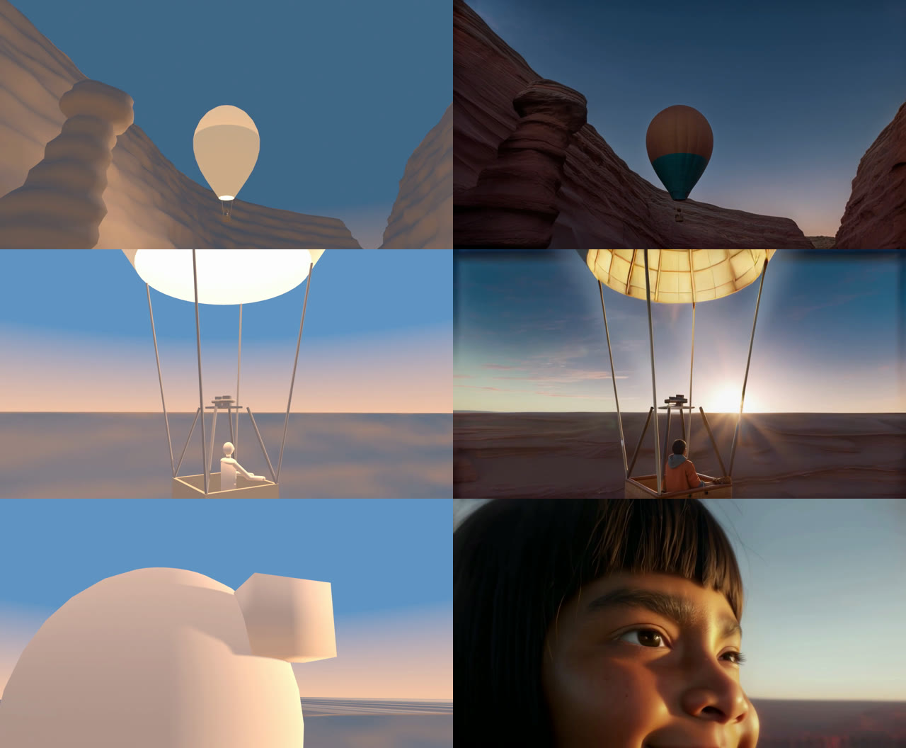
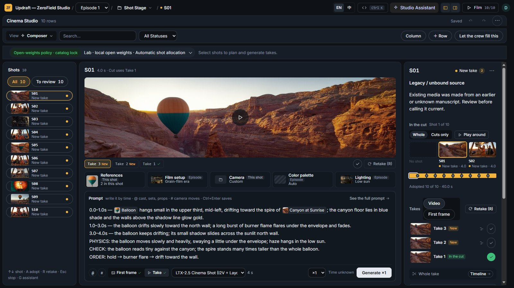
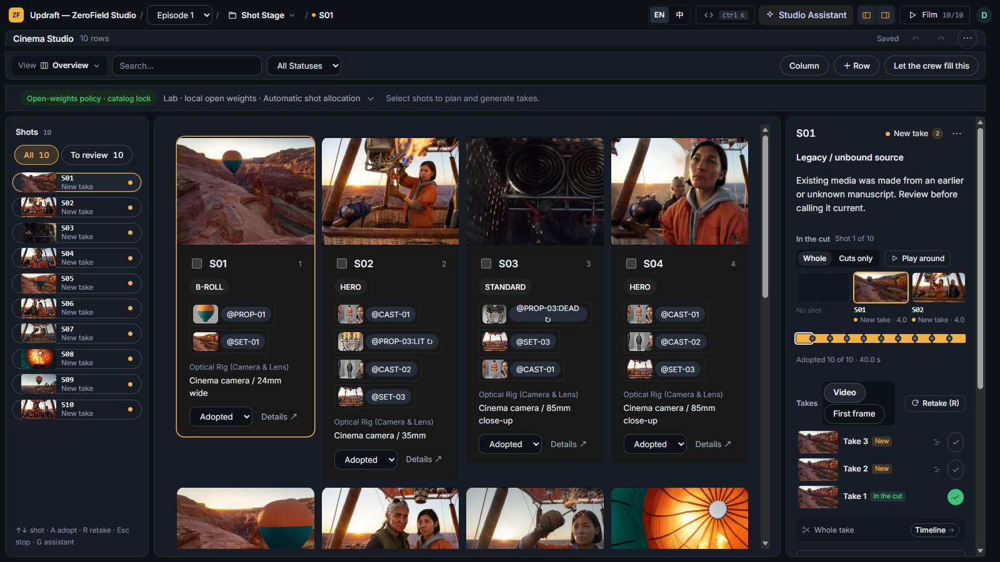
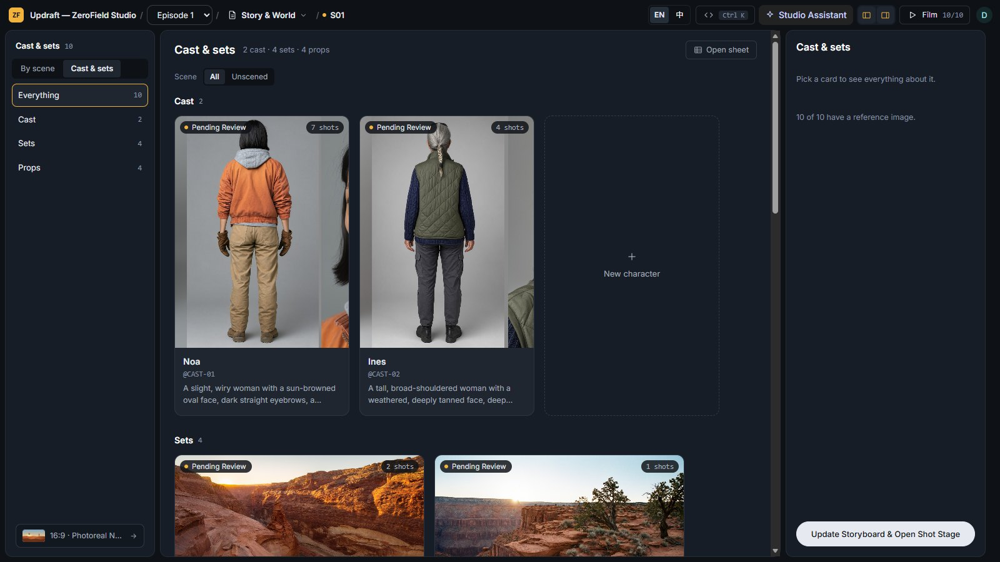
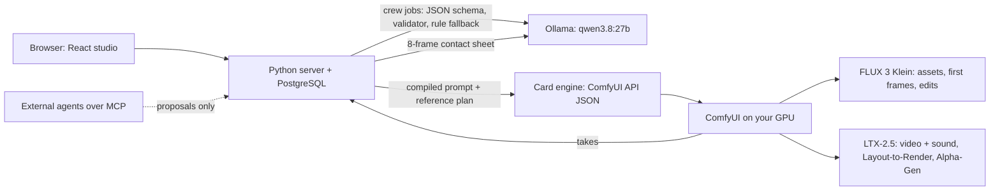

# ZeroField Studio

**An open-weights film crew that plans with you — and checks every shot it makes.**

[▶ Demo video (2 min)](https://youtu.be/17MUH505j3s) · [▶ Updraft one-take (88 s)](https://youtu.be/RbmwLYLcuCA) · [▶ Exported 10-shot film](samples/updraft/updraft_film.mp4) · [Live demo (read-only)](https://fagem-zerofield-studio.hf.space/projects/zerofield-showcase/) · [Run it locally](#run-locally) · MIT · `#OpenSourceHiggsfield`

[](https://youtu.be/RbmwLYLcuCA)

ZeroField is an open-source production workspace for AI films, built on ComfyUI for the [Open Source Higgsfield Challenge](https://comfy.org/open-source-higgsfield). A crew of agents breaks down the script, builds locked character, set and prop assets, compiles each shot's prompt and reference plan, renders it with FLUX 3 Klein and LTX-2.5, and scores the take against the plan before it goes into the cut. Everything the crew writes is a proposal: nothing changes until a person adopts it.

- **Assets first, one job per picture.** A character is a locked description plus a face close-up, a headless full-body front, a back and a composed sheet; sets carry the space and one light logic; props carry a shape lock and separate states. Each asset is stress-tested in new poses and light before any shot is made.
- **Compiled shots.** The first frame gets a reference plan that tells FLUX 3 Klein which picture is the face, the body, the place or the prop. The video prompt follows a fixed skeleton for LTX-2.5: exact head count, location map, camera, timed action, one light and an audio lock.
- **It checks its own takes.** Camera fidelity compares the take's camera path with the 3D plan, and the Continuity Supervisor grades an eight-frame contact sheet with a local vision model; a failing grade comes with a rewritten prompt and a one-click retake.
- **Open weights only.** FLUX 3 Klein, LTX-2.5 (video and sound, with the Layout-to-Render and Alpha-Gen IC-LoRAs), ACE-Step 1.5 for the one-take's score, and a crew on local Ollama `qwen3.8:27b`. No partner nodes, no closed APIs on the demo path. One RTX 4090.

## Start here

1. **Watch the 88-second Updraft one-take**: [on YouTube](https://youtu.be/RbmwLYLcuCA) (file: [`samples/updraft/updraft_oner.mp4`](samples/updraft/updraft_oner.mp4)). A single take up a red canyon before dawn, over the rim into the first sun, a quiet hold on the pilot's face, a push into her eye, and through a chain of circles (pupil, rock pool, moon, sun, the glowing balloon) to the child she was on her first flight. [How it was made](#updraft-two-films).
2. **Watch the episode the studio exported**: [`samples/updraft/updraft_film.mp4`](samples/updraft/updraft_film.mp4), ten shots of the Updraft production, each generated, reviewed and adopted in ZeroField ([samples](samples/README.md)).
3. **Open the studio**: the [read-only live demo](https://fagem-zerofield-studio.hf.space/projects/zerofield-showcase/) needs no install; [without a GPU](#try-it-without-a-gpu) it runs locally for browsing; [Run locally](#run-locally) connects it to your ComfyUI. All three open the Updraft production with its cast, sets, props, shots and takes.

### Updraft: two films

*Updraft* is an original short: a trainee pilot's burner dies over a red canyon at sunrise. It comes in two forms.

- **Ten shots made in the app** (`samples/updraft/`): assets, first frames, takes and the [exported 40-second film](samples/updraft/updraft_film.mp4), all rendered through ZeroField on one RTX 4090. Every file records its card, seed and exact prompt in [`manifest.json`](samples/updraft/manifest.json). The launcher seeds this production, so it is what you see when you open the studio.
- **An 88-second one-take** ([`updraft_oner.mp4`](samples/updraft/updraft_oner.mp4)): nine eight-second slices from one Blender previs camera, each rendered with the LTX-2.5 Layout-to-Render IC-LoRA. Each slice starts on the previous slice's last frame and is guided through FLUX 3 Klein keyframes, the same chaining the studio's **Chain In Frame**, **Mid Key** and **End Key** columns do on a Cinema Studio row. The circle push-through (pupil → rock pool → moon → sun → balloon) is composited from LTX image-to-video plates, and the sound is the takes' own LTX audio with an ACE-Step 1.5 score. The slices, the push-through and the mix were made with the scripts in [`tools/oner/`](tools/oner/README.md), not in the studio's interface.



*Left: the Blender previs. Right: LTX-2.5 Layout-to-Render, same frame.*

### Submission at a glance

| Requirement | Where it is |
|---|---|
| Built with ComfyUI | Every generation is a ComfyUI API graph in [`workflows/`](workflows/README.md); a card binds the compiled prompt and references into its slots, so any step can be opened and run in ComfyUI. Runs on local ComfyUI by default, or through the Comfy SDK. |
| Category | Open Weights Only; bonus: VFX Workflow Built with LTX (LTX-2.5 is the video model of every shot in Updraft) |
| Open-source license | Code: [MIT](LICENSE). Updraft content and media: [CC0](samples/README.md#license). Model weights keep their own licenses ([workflow setup](workflows/README.md)). |
| Run it locally | [Run locally](#run-locally); [without a GPU](#try-it-without-a-gpu) for browsing only |
| Workflow files | [`workflows/*.json`](workflows/README.md) and the card contracts in `workflows/cards/` |
| Other tools used | Ollama with `qwen3.8:27b` for the crew. For the one-take: Blender (previs), ACE-Step 1.5 (score) and Python/OpenCV (push-through, seam fixes, mix), all in [`tools/oner/`](tools/oner/README.md) |
| Demo video | [2 minutes](https://youtu.be/17MUH505j3s) |
| Try it | [Read-only live demo](https://fagem-zerofield-studio.hf.space/projects/zerofield-showcase/) of the Updraft production ([Space](https://huggingface.co/spaces/fagem/zerofield-studio), set up by [`deploy/hf-space/`](deploy/hf-space/Dockerfile)). Nothing can be changed or generated there; generation runs on your own GPU. |
| SFW, original | Updraft is original; no third-party footage, characters, text or real likenesses |

## What's in the studio



 

*The live demo: the shot composer, the Shot Stage overview and the Cast & sets wall.*

Three spaces share one scene and shot focus (Ctrl 1 / 2 / 3):

- **Story & World**: the script in a writing workspace (versions, compare and adopt, which shots an edit affects) and the Cast & sets wall, where every character, set and prop is a locked description plus pictures that each have one job ([SPEC_21](docs/specs/SPEC_21_ASSET_FIRST_PRODUCTION_AND_UPDRAFT.md)).
- **Shot Stage**: a 3D plan for each shot and a shot composer with the current take, the prompt with `@asset` and `#move` tags, the exact compiled prompt and the takes; one ✓ adopts a take into the cut ([SPEC_19](docs/specs/SPEC_19_SHOT_COMPOSER_ADOPTION_AND_FILM_PANEL.md)).
- **Timeline**: per-shot trims, a cut preview and a film export that keeps the trims.

Around them:

- **Layout Render**: the 3D Stage previs drives the LTX-2.5 Layout-to-Render IC-LoRA from a FLUX 3 Klein first frame; **Chain In Frame**, **Mid Key** and **End Key** columns chain slices into longer takes ([workflow](workflows/README.md#layout-render-3d-stage-previs-as-an-ic-lora-layout)).
- **Take review**: camera fidelity compares a take's camera path with the previs, and the Continuity Supervisor grades an eight-frame contact sheet; a failing grade offers a rewritten prompt for a retake. Grades are information only.
- **Crew**: Showrunner, Screenwriter, Cinematographer and Continuity Supervisor on a local model propose beat sheets, camera and lens, appearance descriptions, script breakdowns and 3D blocking. Each job has a JSON schema, a validator and a rule fallback, and nothing is written until a person adopts it ([SPEC_20](docs/specs/SPEC_20_PLANNING_AGENT_LAYER_AND_PROVIDER_PRINCIPLES.md)).
- **OpenJutsu**: video-to-video restyling with a reference image, and Object Swap, which mattes the subject with the Alpha-Gen IC-LoRA and regenerates it with LTX-2.5 ([workflow](workflows/README.md#openjutsu-subject-replacement-object-swap)).
- **ComfyUI underneath**: every step is a ComfyUI API graph bound through a card, and you can import your own graphs and bind their slots. Local ComfyUI or the Comfy SDK.
- **Guard rails**: an open-weights policy lock per production, one GPU queue for renders, grading and model calls, and an Agent Console for providers, spend limits and the queue.
- **External agents** over MCP get scoped, expiring tokens and write proposals only ([setup](docs/EXTERNAL_AGENTS.md)).
- English and Traditional Chinese interface.

Every feature with its limits: [docs/FEATURES.md](docs/FEATURES.md).

### How it fits together



A policy lock keeps a production on open weights, and a GPU arbiter queues ComfyUI renders, grading and model calls on one card. The repository also carries cards for other models (MiniMax H3, and hosted Router, Kling and Seedance cards); hosted and closed cards need an explicitly authorized hybrid production and are not used on the demo path.

### Limits

- Character voices are not built; spoken lines and sound come from LTX-2.5's generated audio.
- Crew planning with the local 27B model is still weak on our hard evaluation set (beats 18.56%, continuity 24.29%). Every crew output is a proposal that a person reviews.
- Starting a blank production from a pasted screenplay still has open break points ([verification history](docs/VERIFICATION_HISTORY.md)).
- The one-take's slices, push-through transitions and mix were made with the scripts in `tools/oner/`, not in the studio's interface; the studio can chain Layout Render slices row by row, but does not composite transitions or score a film.
- Tested only on Windows 11 with one RTX 4090. Linux, the crew under Docker, Comfy Cloud and real MCP hosts are untested.
- Object Swap mattes the whole foreground, so it cannot pick one person out of several.

## Try it without a GPU

The built studio is checked in, so browsing needs only Python 3.11 or 3.12 (no Node, no ComfyUI, no model):

```powershell
py -3.12 -m venv .venv
.venv\Scripts\Activate.ps1
python -m pip install -e ".[embedded]"
python run_studio.py --port 3020 --no-worker
```

Open [http://127.0.0.1:3020/projects/](http://127.0.0.1:3020/projects/) and pick **Updraft**: the Cast & sets wall with each character's face, front, back and sheet, the props and their states, the ten shots with their first frames and takes, the compiled prompts, and the film window. `--no-worker` starts no workers, so nothing calls a model.

## Run locally

Requirements: Python 3.11 or 3.12, Node.js 22+ for frontend development, and PostgreSQL. The `embedded` extra supplies a bundled PostgreSQL through `pgserver`, which has no packages for Python 3.13 or later. On 3.13 or later, install PostgreSQL 15 to 17 yourself and install without the extra (`python -m pip install -e .`); the launcher finds PostgreSQL on `PATH` or in `C:\Program Files\PostgreSQL\<version>\bin`, and `OPENBENCH_PG_BIN` selects another bin directory.

```powershell
py -3.12 -m venv .venv
.venv\Scripts\Activate.ps1
python -m pip install -e ".[embedded]"
npm ci --prefix ui
npm run build --prefix ui
python run_studio.py --port 3020 --no-worker
```

Open [http://127.0.0.1:3020/projects/](http://127.0.0.1:3020/projects/). The launcher seeds the Updraft showcase and the crew once; later launches keep your edits. Without `--no-worker` it also registers local media workers that serve every production on this server. Development mode binds to the local machine and has a crew identity switcher. `--no-worker` is browse only: nothing calls a model; [Models](#models) shows how to turn the crew on.

For local generation, install the models/nodes listed in [workflow setup](workflows/README.md), then run:

```powershell
python run_studio.py --port 3020 --comfy-url http://127.0.0.1:8188
```

For the Comfy Developer Platform, install `.[comfy]` (the official `comfy-sdk` and `comfy-api-proxy`) and select `--platform comfy_sdk`. On your own GPU, run `comfy-api-proxy` next to ComfyUI: it serves the SDK's v2 API on `http://127.0.0.1:8189` in front of ComfyUI on `8188`, and that is the default endpoint when no `COMFY_API_KEY` is set. With a key the SDK targets Comfy Cloud; `--comfy-url` / `COMFY_BASE_URL` selects any other deployment.

```powershell
python -m pip install -e ".[comfy]"
comfy-api-proxy
python run_studio.py --port 3020 --platform comfy_sdk
```

The launcher uses `OPENBENCH_DB_URI` or `DATABASE_URL` when set; otherwise it starts the embedded database on port 55432, or the next free port (`OPENBENCH_PG_PORT` pins it). Token and header sign-in modes never seed demo accounts.

### Tested hardware and render times

Windows 11, one RTX 4090 (24 GB), local ComfyUI 0.42.1. Times are ComfyUI execution times from the 2026-10-30 renders.

| Step | Model | Time per render |
|---|---|---|
| Asset panel or first frame | FLUX 3 Klein (int8) | median 34 s (9–60 s, 38 renders) |
| 4 to 8 s image-to-video clip | LTX-2.5 22B distilled | about 1 min (32–71 s, 7 renders) |
| 8 s Layout Render segment, 193 frames at 1280×704 | LTX-2.5 + Layout-to-Render IC-LoRA | median 4.7 min (268–298 s, 17 renders) |
| Continuity grade of one take | `qwen3.8:27b` vision through Ollama | about 25–45 s |

Eight-second segments decode in tiles to stay under 24 GB. The crew model needs about 17 GB of disk and runs with a 16k context ([Models](#models)).

## Models

The crew (Showrunner, Screenwriter, Cinematographer, Continuity Supervisor) uses a language model for chat, proposed edits and continuity grading; media generation runs on the Comfy workflows above. By default that model is local open weights: [Ollama](https://ollama.com) serving `qwen3.8:27b` at `http://127.0.0.1:11434/v1`. No `OPENBENCH_*` variable is needed.

1. Install Ollama, then pull the model (about 17 GB):

   ```powershell
   ollama pull qwen3.8:27b
   ```

2. Start Ollama with a larger context. On GPUs with less than 24 GiB of VRAM, Ollama's default context is 4k tokens ([Ollama docs](https://docs.ollama.com/context-length)), which can truncate the crew's longer prompts. If the Ollama app is already running, quit it first (or raise the context length in its settings). Then start the server with at least 16384:

   ```powershell
   $env:OLLAMA_CONTEXT_LENGTH=16384; ollama serve
   ```

   ```bash
   OLLAMA_CONTEXT_LENGTH=16384 ollama serve
   ```

   A larger context needs more VRAM. `ollama ps` shows the context in use and whether the model runs fully on the GPU.

   `ollama serve` reads its model folder from `OLLAMA_MODELS`, not from the Ollama app's settings. If you changed the model location in the app (or `OLLAMA_MODELS` points somewhere else), set `OLLAMA_MODELS` to the folder that holds `qwen3.8:27b` before `ollama serve`; otherwise the Agent Board reports the model as missing.

3. Start the studio without `--no-worker`:

   ```powershell
   python run_studio.py --port 3020
   ```

If the crew cannot work (the background worker is off, Ollama is unreachable, or the model has not been pulled), the Agent Board lists what is missing and how to fix it.

The default and the demo path use local open weights only. Another local OpenAI-compatible server (vLLM, llama.cpp server, LM Studio) works through `OPENBENCH_API_BASE` and `OPENBENCH_MODEL`; hosted open-weights and closed models are optional, off by default, and need a showrunner's permission and a price ceiling ([other crew models](docs/FEATURES.md#other-crew-models), [worker setup](docs/WORKERS.md)).

### Connect an external agent

Agents that speak MCP (Claude Code, Goose, MCP Inspector) can work on one production through `zerofield-mcp`, which installs with the package. A showrunner creates a token in Agent Console → Environments & Bridges → **External agents**, choosing its tools, write mode and expiry; everything the agent writes is a proposal, and every call is audited.

```powershell
claude mcp add zerofield -e ZEROFIELD_MCP_TOKEN=zfsa_... -e ZEROFIELD_PROJECT=<production> -- zerofield-mcp
```

The token API, the HTTP endpoint and the 3D preview card are in [docs/EXTERNAL_AGENTS.md](docs/EXTERNAL_AGENTS.md). These paths are tested with fake and in-process clients; no real MCP host has been connected yet.

## Develop and verify

```powershell
python -m unittest discover -s tests -v
npm test --prefix ui
npm run build --prefix ui
python -m pip wheel --no-deps --no-build-isolation --no-index . --wheel-dir "$env:TEMP/zerofield-wheels"
```

Set `OPENBENCH_TEST_DB_URI` to a **dedicated test PostgreSQL database** to run the database integration suite. Without it those tests are skipped. FFmpeg and FFprobe enable the existing media-assembly tests. Frontend changes must be rebuilt because the server serves `static/projects/`.

Last full run, 2026-10-30 at `b7ea8ce`: the backend suite (1,502 tests in four shards on a throwaway PostgreSQL; five environment-sensitive tests passed when re-run alone), the frontend suite (732 tests) and the build. Later commits change documentation, the demo deployment and the showcase's 3D Stage seed in `run_studio.py`, which has its own test. Real-hardware walks and the receipt of each spec: [docs/VERIFICATION_HISTORY.md](docs/VERIFICATION_HISTORY.md).

Read [AGENTS.md](AGENTS.md), [design and development guidelines](docs/DESIGN_AND_DEV_GUIDELINES.md), and the [ZeroField specification](docs/ZEROFIELD_SPEC.md) before extending the application. The specification describes the target product; [What's in the studio](#whats-in-the-studio) describes this checkout.

## Provenance and license

ZeroField is based on OpenBench. The complete M8-A–D / ACP / E1 baseline was imported from commit `a1f5d915bb2cafb8b92d9ff9c6003dc19348fdf9`; its provenance and validation are recorded in [the synchronization receipt](docs/openbench-m8-sync.json). That receipt describes the import checkpoint, before ZeroField-specific changes.

Code is distributed under the [MIT license](LICENSE). Use original or appropriately licensed material for production examples. Model weights and generated or imported media have their own applicable licenses.
