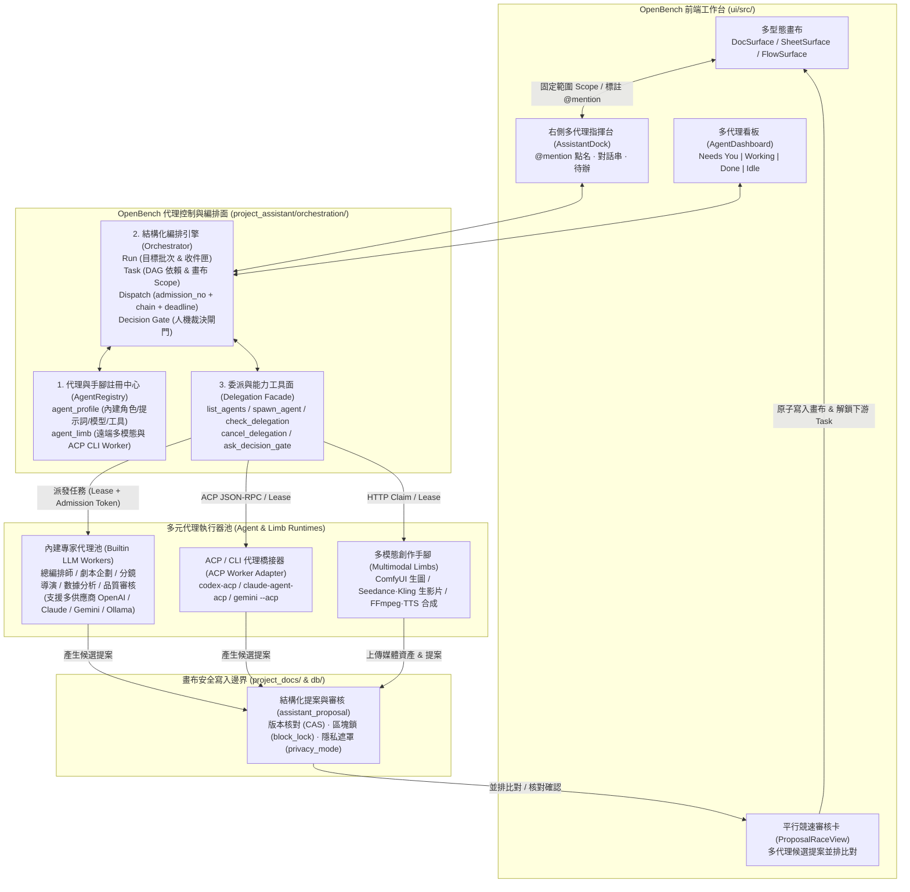
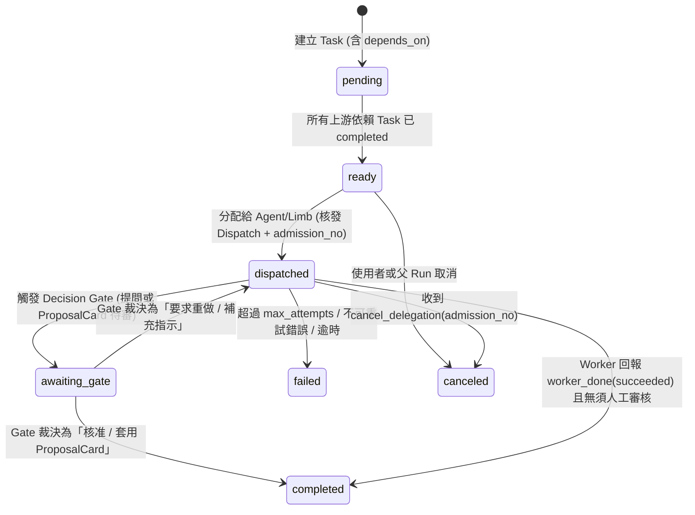

# OpenBench 多代理管理、編排與任務執行層規格書 (`AGENT_ORCHESTRATION_SPEC.md`)

- **狀態**：Draft / Ready for Implementation
- **建立日期**：2026-10-18
- **適用專案**：`C:\ai_project\OpenBench`
- **參考架構**：
  - 本專案既有基礎：[`docs/ARCHITECTURE_AND_HANDOFF.md`](./ARCHITECTURE_AND_HANDOFF.md)、[`docs/EXECUTION_API.md`](./EXECUTION_API.md)、[`docs/WORKERS.md`](./WORKERS.md)
  - 外部參考一（頭手分離與代理控制面）：`C:\ai_agent\openab`（[`DESIGN.md`](file:///C:/ai_agent/openab/DESIGN.md)、[`docs/adr/agent-control-plane.md`](file:///C:/ai_agent/openab/docs/adr/agent-control-plane.md)、[`docs/oab-mcp-facade.md`](file:///C:/ai_agent/openab/docs/oab-mcp-facade.md)、[`docs/multi-agent.md`](file:///C:/ai_agent/openab/docs/multi-agent.md)）
  - 外部參考二（多代理任務編排與看板）：`C:\ai_agent\orca`（[`docs/site/content/docs/cli/orchestration.mdx`](file:///C:/ai_agent/orca/docs/site/content/docs/cli/orchestration.mdx)、[`docs/site/content/docs/model/agents-sessions.mdx`](file:///C:/ai_agent/orca/docs/site/content/docs/model/agents-sessions.mdx)、[`docs/site/content/docs/recipes/parallel-agents.mdx`](file:///C:/ai_agent/orca/docs/site/content/docs/recipes/parallel-agents.mdx)）

---

## 1. 背景與現況診斷（Why & Current Gaps）

### 1.1 現有架構盤點

目前 OpenBench 的代理能力分散在 [`project_assistant/`](../project_assistant/) 下的兩套彼此割裂的機制中：

1. **右側對話助理（[`worker.py`](../project_assistant/worker.py) + [`service.py`](../project_assistant/service.py) + [`prompts/system.md`](../project_assistant/prompts/system.md)）**
   - **單一角色寫死**：全系統共用同一份 `prompts/system.md` 與 `prompts/knowledge.md`，無法針對「劇本編劇」、「分鏡導演」、「數據分析師」、「美術審核」或「總編排師」定義不同的專業代理角色與工具權限。
   - **單一全域模型**：僅透過環境變數 `OPENBENCH_PROVIDER` / `OPENBENCH_MODEL` 指定單一模型，無法讓不同代理綁定最適合的模型（例如推理規劃用 Claude / GPT、批次填表用輕量快速模型、本地隱私資料用 Ollama）。
   - **單線阻塞（Single-Flight Blocking）**：[`service.py:send()`](../project_assistant/service.py#L118) 透過 `store.open_reply()` 限制同一成員同一時間只能有一則回答在跑（回傳 HTTP 409 `"上一句還在回答，等它答完再送"`），無法同時派發多個背景任務。
   - **無法驅動子代理或外部手腳**：對話助理只能自己呼叫 [`tools.py`](../project_assistant/tools.py) 的讀頁與提案工具，不能把工作拆解委派給其他專家代理，也無法調度已註冊的 `agent_limb`（生圖、生影片、合成手腳）或觸發 `FlowSurface` 產線。

2. **節點工作流與遠端手腳（[`flow_runner.py`](../project_assistant/flow_runner.py) + [`limbs.py`](../project_assistant/limbs.py) + [`limb_worker.py`](../project_assistant/limb_worker.py)）**
   - **手腳僅為無狀態單發 Adapter**：`agent_limb` 雖具備租約（Lease）機制，但其中的 `llm` 能力只是單輪 `response_format={"type": "json_object"}` 呼叫（見 [`limb_worker.py:llm()`](../project_assistant/limb_worker.py#L117)），沒有多步工具呼叫（Tool Loop）、無法按需查閱畫布或報表、也沒有代理身分（Agent Profile）。
   - **靜態拓撲限制**：工作流必須事先由使用者在 `FlowSurface` 手動拉好節點與連線；當使用者面對臨時性複雜任務（例如：「幫我對照劇本與角色設定表，檢查 EP01 分鏡表哪幾鏡不連戲，生出三版修正提案並重抽問題鏡頭的首幀圖」），缺乏一個能**動態拆解任務、派發多代理平行協作、匯總結果**的編排層。

---

### 1.2 從 `openab` 與 `orca` 吸收的核心設計（借鑑與不照搬原則）

| 參考來源 | 借鑑的核心機制（納入本規格） | 不照搬的部分（保持 OpenBench 輕量與定位） |
| :--- | :--- | :--- |
| **`C:\ai_agent\openab`**<br>*(Agent Control Plane & ACP Harness)* | 1. **Control Plane 角色分層（`primary` / `worker` / `observer`）與標籤路由（Label Selector）**：區分面對人類的主控代理與專職任務的執行代理。<br>2. **精確派發憑證 `(delegation_id, admission_no)`**：每次派發或重試都核發單調遞增的 `admission_no`，杜絕取消後重試時的遲到結果覆寫（Stale Result Misdelivery）。<br>3. **CP 建構的呼叫鏈 `chain` 與絕對 `deadline` 傳遞**：防止代理循環委派（Cycle Detection）、強制限制委派深度（預設 `max_depth = 1` 防 Token 暴衝），且子任務超時不得超過父任務剩餘時間。<br>4. **極簡 4 工具委派 Facade**：主代理只需 `list_agents`、`spawn_agent`、`check_delegation`、`cancel_delegation` 四個標準工具即可編排整個代理池。<br>5. **ACP stdio / 外部 CLI 代理橋接**：支援將本機或容器內的 Claude Code、Codex、Gemini CLI 封裝為標準 Worker。 | - 不引入 Discord / Slack / Telegram 聊天平台 Gateway（OpenBench 本身就是多型態畫布工作台）。<br>- 不強制依賴獨立 Rust `openab-cp` 二進位檔或 K8s Pod 隔離；控制面直接內建於 OpenBench Python + PostgreSQL 交易中，遠端代理透過既有 HTTP Bearer Token / Lease 協定接入。 |
| **`C:\ai_agent\orca`**<br>*(Multi-Agent Orchestrator)* | 1. **結構化編排五元組（`Run` → `Task` → `Dispatch` → `Message` → `Decision Gate`）**：將「目標批次」、「依賴任務」、「單次派發實例」、「收件匣通訊」與「人類／主代理決策閘門」明確分離。<br>2. **強制結果回報契約（Mandatory `worker_done`）**：Worker 結束時由執行期強制產生終態幀，不依賴模型「記得呼叫工具回報」。<br>3. **四態代理看板（Agent Dashboard：`Needs You` / `Working` / `Done` / `Idle`）**：一眼掌握所有背景代理進度，哪個代理卡在提案審核或問題裁決（Amber 提示）立即可見。<br>4. **平行競速模式（Parallel Agent Racing）**：同一任務同時派給 2～3 個不同代理／模型平行產出候選 `ProposalCard`，由使用者並排比對、一鍵擇優套用。 | - **不做程式碼 IDE**：不引入 Git Worktree 分支管理、Ghostty WebGL 終端機分割或 Monaco Code Diff（OpenBench 的「Worktree 隔離」對應的是 **「畫布版本快照 + 獨立候選 `ProposalCard`」**，在未按確認前絕不污染畫布主線）。 |

---

## 2. 系統架構總覽（Target Architecture）



---

## 3. 五大核心設計支柱

### 3.1 支柱一：統一的代理角色與手腳註冊中心（Unified Agent Registry）

將原本寫死的單一助理，升級為可動態配置與擴充的 **`projectops.agent_profile`（代理角色設定表）**，並與既有的 **`projectops.agent_limb`（遠端執行手腳表）** 無縫結合。

#### 代理分類（`role_kind` — 借鏡 `openab` Control Plane）
1. **`primary`（主控／協調代理）**：
   - 直接在右側 `AssistantDock` 與使用者對話，具備全域視野與委派工具（`spawn_agent` 等）。
   - 能回答問題、直接操作畫布提案，或在任務複雜時自動建立 `Orchestration Run`，把子任務拆給 `worker` 代理平行處理。
2. **`worker`（專職專家代理／多模態手腳）**：
   - 專精特定領域（如：`writer` 劇本編劇、`storyboard` 分鏡拆解、`data_analyst` 報表公式診斷、`qa_reviewer` 連戲與口徑審核、`image_gen` 生圖手腳、`video_gen` 影片手腳）。
   - 支援兩類觸發方式：
     - **被動委派**：由 `primary` 代理透過 `spawn_agent` 調度，或由 `FlowSurface` 節點綁定呼叫。
     - **主動點名（`@mention`）**：使用者在對話框或畫布標註留言直接輸入 `@storyboard 幫我把第一場拆成 8 鏡`，系統直接將該輪訊息路由給 `storyboard` 代理執行。
3. **`observer`（唯讀監控／稽核）**：
   - 僅訂閱編排事件流（如看板 UI、自動化通知、外部日誌收集），不可發起或承接委派。

#### 內建預設代理編制（Default Agent Roster）
每個新專案初始化時，預設提供以下可自訂、可替換模型的代理編制（透過資料庫與設定檔管理，不再寫死於單一 `system.md`）：

| `agent_key` | 顯示名稱 | `role_kind` | 預設能力與標籤 (`capabilities` / `labels`) | 允許工具 (`allowed_tools`) | 職責說明 |
| :--- | :--- | :---: | :--- | :--- | :--- |
| `coordinator` | **🧭 專案總編排** | `primary` | `["llm", "orchestrate"]`<br>`{"domain": "general"}` | 全部畫布工具 ＋ 委派工具 (`spawn_agent` 等) | 預設對話窗口；負責理解跨分頁需求、拆解多步任務、派發專家代理並彙整結果。 |
| `doc_writer` | **✍️ 企劃與劇本代理** | `worker` | `["llm"]`<br>`{"domain": "writing", "surface": "doc"}` | `list_pages`, `read_page`, `search_pages`, `propose`, `offer_document` | 專精長文撰寫、劇本場次對白潤飾、企劃書結構整理與段落標註修訂。 |
| `sheet_ops` | **📊 表格與分鏡量產代理** | `worker` | `["llm"]`<br>`{"domain": "sheet", "surface": "sheet"}` | `list_pages`, `read_page`, `propose_table_edit`, `report_*` | 專精試算表批次填寫、劇本拆鏡（輸出結構化分鏡列）、公式診斷與跨表數據核對。 |
| `qa_critic` | **🔍 審核與驗收代理** | `worker` | `["llm"]`<br>`{"domain": "review"}` | `list_pages`, `read_page`, `search_pages`, `report_*`, `propose`（僅限加標註/留言） | 專精挑錯：檢查分鏡與角色設定是否連戲、報表數字與口徑是否矛盾，並在問題處加上螢光筆標註。 |
| `limb:*` | **🔌 外部多模態與 CLI 手腳** | `worker` | `["image_gen" \| "video_gen" \| "media_assemble" \| "acp_cli"]` | 依手腳協定限制於單一任務範圍 | 由管理員透過 `/projects/api/limbs/register` 註冊的遠端 ComfyUI、影片生成、FFmpeg 或本機 Codex/Claude ACP Worker。 |

---

### 3.2 支柱二：結構化多代理編排模型（Run / Task / Dispatch / Gate）

為了讓「右側對話臨時交辦的多代理任務」、「表格勾選 20 列批次任務」與「`FlowSurface` 固定節點產線」共用同一套可靠的執行底層，我們將 `orca` 的五元組與 `openab` 的 Admission 安全契約整合為以下核心模型：



#### 關鍵安全與一致性契約（吸收自 `openab` ADR 與 `orca`）

1. **精確派發憑證（Admission Token：`dispatch_id` + `admission_no`）**
   - 每個 `orchestration_task` 可以因為重試（Retry）或改派其他代理而產生多次 `orchestration_dispatch`，每次派發在專案內配發一個嚴格單調遞增的整數 `admission_no`。
   - 對外給代理或 CLI 的 Handle 封裝為不透明字串 `dsp_<dispatch_id>_<admission_no>`。
   - **Commit 鐵律**：當 Worker 回報完成（`complete`）、上傳媒體或發送取消（`cancel`）時，**必須同時比對 `(task_id, dispatch_id, admission_no)`**。若某個被取消或逾時的舊派發（`admission_no = 41`）在任務已被重新派發（`admission_no = 42`）後才遲到回傳結果，系統比對 `admission_no` 不符即安全丟棄，絕不污染新派發的狀態或誤寫入畫布。

2. **呼叫鏈追蹤與防爆衝策略（CP-Constructed `chain` & Policy）**
   - 每個 `orchestration_dispatch` 由後端自動記錄 `chain`（例如 `["user:alex", "agent:coordinator", "agent:sheet_ops"]`），絕不由模型自行填寫。
   - **預設安全策略（Conservative Policy by Default）**：
     - 預設只有 `role_kind = 'primary'` 的代理可以呼叫 `spawn_agent`。
     - 預設最大委派深度 `max_depth = 1`（`primary` → `worker`），防止 `worker` 無限衍生子代理造成 Token 費用失控（專案設定可按需放寬至 `max_depth = 2`，但嚴格禁止 `target_agent` 已存在於 `chain` 中的循環委派）。
     - 單一 `Run` 預設最多同時執行 `max_parallel_dispatches = 6` 個任務，單一 `Run` 總任務上限 `max_tasks_per_run = 200`。

3. **絕對截止時間傳遞（Propagated `deadline_at`）**
   - 父任務委派子任務時，子任務的 `deadline_at` 取 `min(caller_requested_deadline, parent_deadline_at)`。一旦父任務取消或到期，背景 Sweeper 立即將旗下所有未完成的子 Dispatch 標記為 `canceled`，停止消耗模型額度。

4. **平行競速模式（Parallel Agent Racing — `strategy = 'race'`）**
   - 借鏡 `orca` 的 Parallel Agents 概念，並結合 OpenBench 獨有的 `ProposalCard` 機制：
   - 當使用者或 `coordinator` 選擇以 **競速模式（Race Mode）** 執行任務（例如同時指定 `agents = ["doc_writer", "claude_cli", "gemini_pro"]` 撰寫劇本段落或分鏡 Prompt）：
     - 系統在同一個 `Task` 下同時建立 3 個平行 `Dispatch`（各自擁有獨立 `dispatch_id` 與 `admission_no`）。
     - 3 個代理各自讀取同一份畫布快照，平行產出 3 張帶有 `race_group_id = task.id` 的候選 `ProposalCard`。
     - 使用者在 UI 的 **競速比對視圖（Proposal Race View）** 並排檢視 3 個版本的差異，點擊其中一版的「✓ 選用此版」，系統即原子套用該提案，並自動將同 `race_group_id` 的另外兩張候選提案標記為 `dismissed`，同時解鎖下游依賴任務！

---

### 3.3 支柱三：主控代理的委派工具面（Delegation & Orchestration Tools）

在 [`project_assistant/tool_specs.py`](../project_assistant/tool_specs.py) 與 [`project_assistant/tools.py`](../project_assistant/tools.py) 中，為具備 `orchestrate` 權限的 `primary` 代理新增 6 個標準編排工具（同時支援內建 OpenAI-compat 迴圈與 MCP stdio）：

| 工具名稱 | 用途與行為說明 | 關鍵輸入參數 | 回傳內容（給模型） |
| :--- | :--- | :--- | :--- |
| **`list_agents`** | 列出當前專案可用的專家代理與已連線的外部手腳（含能力、標籤、模型、目前負載）。 | `capability` (可選), `domain` (可選) | 結構化清單：`agent_key`, `name`, `role_kind`, `capabilities`, `labels`, `status (online/busy/offline)`, `active_dispatches/max_concurrency`。 |
| **`spawn_agent`** | 委派一項子任務給指定代理、依標籤配對代理，或對多個代理發起平行競速（`race`）／對表格多列發起批次派發（`fanout_rows`）。 | `objective` (必填), `target_agent` 或 `label_selector`, `scope` (`tab_key`, `row_ids`, `column_ids`), `depends_on` (可選), `strategy` (`single` \| `race` \| `fanout_rows`), `race_agents` (可選), `wait` (`true` 同步等待結果 \| `false` 立即回傳 handle) | 若 `wait=true` 且在時限內完成，直接回傳子代理的 `summary` 與產出的 `proposal_ids`；若 `wait=false` 或轉入待審核閘門，回傳 `run_id`, `task_id`, `dispatch_handles` 供後續追蹤。 |
| **`check_delegation`** | 查詢一個或整個 `Run` 的子任務進度、Worker 回報摘要與待決策閘門。 | `run_id` 或 `dispatch_handle` | 各子任務的 `status`、`worker_summary`、產出的 `ProposalCard` 編號與目前是否卡在 `DecisionGate`。 |
| **`cancel_delegation`** | 取消指定的執行中派發（精確核對 `dispatch_handle` 內的 `admission_no`）並作廢其未決提案。 | `dispatch_handle`, `reason` | `{canceled: true, dispatch_handle}`。 |
| **`ask_decision_gate`** | 當代理遇到需要人類拍板的關鍵分歧（例如「這 20 鏡要採寫實風還是賽博龐克風？」），建立結構化選項卡並暫停後續依賴任務。 | `question`, `options` (字串陣列 2～5 項), `context_tab` (可選), `blocking_task_ids` (可選) | 建立 `orchestration_gate` 並回傳 `gate_id`，右側與看板亮起 Amber `Needs You` 提示。 |
| **`trigger_flow_run`** | 讓對話代理能直接啟動或單步試跑 `FlowSurface` 分頁上已定義的 DAG 產線（打通對話與節點工作流）。 | `flow_tab_key`, `start_node_id` (可選), `row_ids` (可選), `target_tab` (可選) | 回傳 `flow_run_id` 與初始展開的任務數，並掛入同一個看板追蹤。 |

---

### 3.4 支柱四：多通道觸發與 `FlowSurface` 深度整合

1. **右側對話框 `@mention` 點名與代理切換器**
   - 使用者在右側對話輸入框可由頂部下拉選單切換預設對話代理（預設為 `🧭 專案總編排 coordinator`，也可切為專職 `✍️ 企劃與劇本 doc_writer` 或 `📊 表格量產 sheet_ops`）。
   - 在任何對話中輸入 `@doc_writer`、`@sheet_ops`、`@qa_critic`（前端支援輸入 `@` 彈出代理自動補全選單），該則訊息即指定 `target_agent_key` 交由該代理回答。
2. **畫布螢光筆標註與表格單列直接呼叫指定代理**
   - 在 `DocSurface` 選取段落留言，或在 `SheetSurface` 勾選多列點「✦ 交給代理執行」時，除了輸入指令，還可選擇「指派給哪個代理」或勾選「⚡ 多代理競速（同時產生 2～3 版提案供挑選）」。
3. **`FlowSurface` 節點支援綁定 `agent_key`**
   - 擴充 [`flow_runner.py:validate_definition()`](../project_assistant/flow_runner.py#L21) 的節點結構：節點除了可指定 `capability` 與遠端 `limb_id` 外，新增可選欄位 `agent_key`（指向 `projectops.agent_profile`）。
   - 當 `FlowSurface` 執行到綁定 `agent_key` 的節點時，內建 Worker 會載入該 `agent_profile` 的專屬 System Prompt、知識包、模型設定與工具白名單來執行該節點任務！

---

### 3.5 支柱五：前端「多代理指揮台（Agent Dashboard & Dock）」介面規格

借鏡 `orca` 的 Agent Dashboard 與 Taste 極簡工作台原則（按需展開、不遮擋中間畫布主視覺）：

1. **`AssistantDock` 頂部狀態列（常駐輕量指標）**
   - 顯示目前對話的代理名稱與模型標籤（如 `🧭 專案總編排 · DeepSeek / Claude`）。
   - 顯示即時膠囊計數器：
     - 琥珀色 **`? 待你裁決 (N)`**（Needs You：有待確認的 `ProposalCard` 或 `DecisionGate` 提問）
     - 藍色旋轉 **`⟳ 執行中 (M)`**（Working：背景正在跑的 `Dispatch` 或 `FlowRun`）
   - 點擊膠囊即可在側邊欄內切換至 **「⚡ 代理編排看板 (Agent Board)」** 分頁，或彈出寬版浮層。

2. **四欄式／四分組代理看板（Agent Board）**
   - **① 待你裁決 (`Needs You` — Amber 強調)**：
     - 集中列出所有卡在 `awaiting_approval`（待審核 `ProposalCard` / 競速比對卡）與 `awaiting_gate`（代理提問 `DecisionGate`）的任務。
     - 使用者不必翻找各分頁或長對話，直接在卡片上點選答案按鈕或打開前後對照審核，一鍵放行下游任務！
   - **② 執行中 (`Working` — 即時進度)**：
     - 顯示每個活動中 `Dispatch` 的負責代理圖示、目標分頁／列數、目前正在呼叫的工具（如 `正在讀取：EP01 分鏡量產表`）、已耗時秒數，以及「✕ 取消」按鈕。
   - **③ 已完成 (`Done` — 成果追蹤)**：
     - 顯示最近完成的 `Run` 與 `Dispatch`，附帶 Worker 的一句話結案摘要（`worker_done` summary）與「↗ 跳轉至修改分頁」按鈕。
   - **④ 代理與手腳池 (`Roster & Limbs`)**：
     - 顯示本專案已啟用的內建專家代理（可由管理員編輯 Prompt、切換模型供應商、開關工具權限）與外部已連線的 `agent_limb`（顯示連線綠燈、能力標籤与並發配額）。

---

## 4. 資料庫 Schema 設計（`db/158_agent_orchestration.sql`）

以下 SQL 將新增於 `db/158_agent_orchestration.sql`，由 `project_docs.repository.ensure_schema()` 在 `157_execution.sql` 之後自動套用（全部具備 `IF NOT EXISTS` 冪等性）：

```sql
-- 158_agent_orchestration.sql
-- 多代理角色註冊 (agent_profile)、結構化編排批次 (orchestration_run)、
-- 任務依賴圖 (orchestration_task)、精確派發憑證 (orchestration_dispatch)、
-- 收件匣通訊 (orchestration_message) 與決策閘門 (orchestration_gate)。

-- 1. 專案代理角色定義表 (Agent Profiles)
CREATE TABLE IF NOT EXISTS projectops.agent_profile (
  project_slug     TEXT NOT NULL REFERENCES projectops.project(slug) ON DELETE CASCADE,
  agent_key        TEXT NOT NULL,
  display_name     TEXT NOT NULL,
  icon             TEXT NOT NULL DEFAULT '🤖',
  role_kind        TEXT NOT NULL DEFAULT 'worker'
                   CHECK (role_kind IN ('primary', 'worker', 'observer')),
  runtime_kind     TEXT NOT NULL DEFAULT 'builtin_llm'
                   CHECK (runtime_kind IN ('builtin_llm', 'acp_stdio', 'remote_limb')),
  description      TEXT NOT NULL DEFAULT '',
  system_prompt    TEXT NOT NULL DEFAULT '',
  knowledge_pack   TEXT NOT NULL DEFAULT '',
  capabilities     JSONB NOT NULL DEFAULT '["llm"]'::jsonb,
  labels           JSONB NOT NULL DEFAULT '{}'::jsonb,
  allowed_tools    JSONB NOT NULL DEFAULT '[]'::jsonb,
  provider_config  JSONB NOT NULL DEFAULT '{}'::jsonb, -- {kind, base_url, api_key_env, model, effort}
  bound_limb_id    UUID REFERENCES projectops.agent_limb(id) ON DELETE SET NULL,
  max_concurrency  INTEGER NOT NULL DEFAULT 2 CHECK (max_concurrency BETWEEN 1 AND 32),
  enabled          BOOLEAN NOT NULL DEFAULT TRUE,
  created_by       UUID,
  created_at       TIMESTAMPTZ NOT NULL DEFAULT NOW(),
  updated_at       TIMESTAMPTZ NOT NULL DEFAULT NOW(),
  PRIMARY KEY (project_slug, agent_key)
);

-- 2. 專案級單調遞增 Admission Counter（防重試與取消競態，借鏡 openab CP）
CREATE TABLE IF NOT EXISTS projectops.orchestration_Admission_seq (
  project_slug     TEXT PRIMARY KEY REFERENCES projectops.project(slug) ON DELETE CASCADE,
  last_admission   BIGINT NOT NULL DEFAULT 0
);

-- 3. 編排執行批次 (Orchestration Run — 對應一次高階目標或跨代理協作)
CREATE TABLE IF NOT EXISTS projectops.orchestration_run (
  id               UUID PRIMARY KEY,
  project_slug     TEXT NOT NULL REFERENCES projectops.project(slug) ON DELETE CASCADE,
  conversation_id  BIGINT REFERENCES projectops.assistant_conversation(id) ON DELETE SET NULL,
  trigger_message_id BIGINT REFERENCES projectops.assistant_message(id) ON DELETE SET NULL,
  flow_run_id      UUID REFERENCES projectops.flow_run(id) ON DELETE SET NULL,
  coordinator_key  TEXT NOT NULL DEFAULT 'coordinator',
  objective        TEXT NOT NULL,
  status           TEXT NOT NULL DEFAULT 'active'
                   CHECK (status IN ('active', 'awaiting_gate', 'succeeded', 'failed', 'canceled')),
  max_depth        INTEGER NOT NULL DEFAULT 1 CHECK (max_depth BETWEEN 1 AND 3),
  summary          TEXT NOT NULL DEFAULT '',
  created_by       UUID NOT NULL,
  deadline_at      TIMESTAMPTZ,
  created_at       TIMESTAMPTZ NOT NULL DEFAULT NOW(),
  updated_at       TIMESTAMPTZ NOT NULL DEFAULT NOW(),
  finished_at      TIMESTAMPTZ
);
CREATE INDEX IF NOT EXISTS orchestration_run_project_idx
  ON projectops.orchestration_run (project_slug, created_at DESC);

-- 4. 編排任務節點 (Orchestration Task — 支援 DAG 依賴與 Parallel Race)
CREATE TABLE IF NOT EXISTS projectops.orchestration_task (
  id               UUID PRIMARY KEY,
  run_id           UUID NOT NULL REFERENCES projectops.orchestration_run(id) ON DELETE CASCADE,
  project_slug     TEXT NOT NULL,
  title            TEXT NOT NULL,
  spec             TEXT NOT NULL,
  strategy         TEXT NOT NULL DEFAULT 'single'
                   CHECK (strategy IN ('single', 'race', 'fanout_rows')),
  target_agent_key TEXT,
  label_selector   JSONB NOT NULL DEFAULT '{}'::jsonb,
  request_scope    JSONB,                              -- {target_tab, table_id, row_ids, column_ids}
  depends_on       JSONB NOT NULL DEFAULT '[]'::jsonb, -- 上游 task UUID 陣列
  write_mode       TEXT NOT NULL DEFAULT 'proposal'
                   CHECK (write_mode IN ('proposal', 'direct', 'analysis_only')),
  status           TEXT NOT NULL DEFAULT 'pending'
                   CHECK (status IN ('pending', 'ready', 'dispatched', 'awaiting_gate', 'completed', 'failed', 'canceled')),
  winning_dispatch_id UUID,                            -- Race 模式下勝出的 dispatch
  result_summary   TEXT NOT NULL DEFAULT '',
  error            TEXT,
  created_at       TIMESTAMPTZ NOT NULL DEFAULT NOW(),
  updated_at       TIMESTAMPTZ NOT NULL DEFAULT NOW()
);
CREATE INDEX IF NOT EXISTS orchestration_task_run_idx
  ON projectops.orchestration_task (run_id, created_at);

-- 5. 任務派發實例 (Orchestration Dispatch — 綁定 admission_no、chain 與租約)
CREATE TABLE IF NOT EXISTS projectops.orchestration_dispatch (
  id               UUID PRIMARY KEY,
  run_id           UUID NOT NULL REFERENCES projectops.orchestration_run(id) ON DELETE CASCADE,
  task_id          UUID NOT NULL REFERENCES projectops.orchestration_task(id) ON DELETE CASCADE,
  project_slug     TEXT NOT NULL,
  admission_no     BIGINT NOT NULL,                    -- 單調遞增憑證，Commit/Cancel 必核對
  agent_key        TEXT NOT NULL,
  limb_id          UUID REFERENCES projectops.agent_limb(id) ON DELETE SET NULL,
  row_id           TEXT NOT NULL DEFAULT '',           -- fanout_rows 時對應單列 ID
  chain            JSONB NOT NULL DEFAULT '[]'::jsonb, -- CP 建構的呼叫鏈，如 ["user:...", "agent:coordinator"]
  status           TEXT NOT NULL DEFAULT 'queued'
                   CHECK (status IN ('queued', 'running', 'awaiting_gate', 'succeeded', 'failed', 'timeout', 'canceled')),
  attempts         INTEGER NOT NULL DEFAULT 0,
  max_attempts     INTEGER NOT NULL DEFAULT 2,
  lease_owner      TEXT,
  lease_hash       TEXT,
  lease_until      TIMESTAMPTZ,
  deadline_at      TIMESTAMPTZ,
  tools_trace      JSONB NOT NULL DEFAULT '[]'::jsonb,
  partial_text     TEXT NOT NULL DEFAULT '',
  output_json      JSONB,
  proposal_id      BIGINT REFERENCES projectops.assistant_proposal(id) ON DELETE SET NULL,
  error            TEXT,
  created_at       TIMESTAMPTZ NOT NULL DEFAULT NOW(),
  updated_at       TIMESTAMPTZ NOT NULL DEFAULT NOW(),
  finished_at      TIMESTAMPTZ,
  UNIQUE (project_slug, admission_no)
);
CREATE INDEX IF NOT EXISTS orchestration_dispatch_claim_idx
  ON projectops.orchestration_dispatch (project_slug, status, created_at)
  WHERE status IN ('queued', 'running');
CREATE INDEX IF NOT EXISTS orchestration_dispatch_task_idx
  ON projectops.orchestration_dispatch (task_id, created_at);

-- 6. 結構化收件匣與事件流 (Orchestration Inbox Messages)
CREATE TABLE IF NOT EXISTS projectops.orchestration_message (
  id               BIGSERIAL PRIMARY KEY,
  run_id           UUID NOT NULL REFERENCES projectops.orchestration_run(id) ON DELETE CASCADE,
  task_id          UUID REFERENCES projectops.orchestration_task(id) ON DELETE CASCADE,
  dispatch_id      UUID REFERENCES projectops.orchestration_dispatch(id) ON DELETE CASCADE,
  admission_no     BIGINT,
  project_slug     TEXT NOT NULL,
  sender           TEXT NOT NULL,                      -- e.g. 'agent:sheet_ops', 'user:<uuid>', 'system:cp'
  recipient        TEXT NOT NULL,                      -- e.g. 'run:<uuid>', 'dispatch:<uuid>', '@all'
  msg_type         TEXT NOT NULL
                   CHECK (msg_type IN ('dispatch', 'progress', 'heartbeat', 'question', 'escalation', 'worker_done', 'system')),
  subject          TEXT NOT NULL DEFAULT '',
  body             TEXT NOT NULL DEFAULT '',
  payload          JSONB NOT NULL DEFAULT '{}'::jsonb,
  acked_at         TIMESTAMPTZ,
  created_at       TIMESTAMPTZ NOT NULL DEFAULT NOW()
);
CREATE INDEX IF NOT EXISTS orchestration_message_inbox_idx
  ON projectops.orchestration_message (run_id, acked_at, id);

-- 7. 人機與協調決策閘門 (Decision Gates — Needs You 佇列)
CREATE TABLE IF NOT EXISTS projectops.orchestration_gate (
  id               UUID PRIMARY KEY,
  run_id           UUID NOT NULL REFERENCES projectops.orchestration_run(id) ON DELETE CASCADE,
  task_id          UUID NOT NULL REFERENCES projectops.orchestration_task(id) ON DELETE CASCADE,
  dispatch_id      UUID REFERENCES projectops.orchestration_dispatch(id) ON DELETE SET NULL,
  project_slug     TEXT NOT NULL,
  gate_kind        TEXT NOT NULL DEFAULT 'question'
                   CHECK (gate_kind IN ('question', 'proposal_review', 'race_select', 'escalation')),
  question         TEXT NOT NULL,
  options          JSONB NOT NULL DEFAULT '[]'::jsonb, -- ["選項 A", "選項 B"] 或候選 proposal_id 列表
  status           TEXT NOT NULL DEFAULT 'open'
                   CHECK (status IN ('open', 'resolved', 'dismissed')),
  resolution       TEXT,
  resolved_by      UUID,
  created_at       TIMESTAMPTZ NOT NULL DEFAULT NOW(),
  resolved_at      TIMESTAMPTZ
);
CREATE INDEX IF NOT EXISTS orchestration_gate_open_idx
  ON projectops.orchestration_gate (project_slug, status, created_at DESC)
  WHERE status = 'open';

-- 8. 擴充既有對話訊息與提案表，支援綁定特定代理與競速群組
ALTER TABLE projectops.assistant_message
  ADD COLUMN IF NOT EXISTS agent_key TEXT NOT NULL DEFAULT 'coordinator',
  ADD COLUMN IF NOT EXISTS run_id UUID REFERENCES projectops.orchestration_run(id) ON DELETE SET NULL;

ALTER TABLE projectops.assistant_proposal
  ADD COLUMN IF NOT EXISTS agent_key TEXT,
  ADD COLUMN IF NOT EXISTS dispatch_id UUID REFERENCES projectops.orchestration_dispatch(id) ON DELETE SET NULL,
  ADD COLUMN IF NOT EXISTS race_group_task_id UUID REFERENCES projectops.orchestration_task(id) ON DELETE SET NULL;
```

---

## 5. 後端模組設計與 API 契約

### 5.1 新增與擴充的後端檔案結構 (`project_assistant/`)

為了保持單一職責與清晰命名（避免 `utils` / `helpers` 大雜燴），在 `project_assistant/` 下新增以下模組：

1. **`project_assistant/agent_registry.py`**
   - 負責 `projectops.agent_profile` 的預設種子初始化（`ensure_default_agents(conn, slug)`）、CRUD、依 `agent_key` 或 `label_selector` 查詢可用代理、以及將外部 `agent_limb` 映射為統一的 Agent Roster 視圖。
   - 支援解析對話中的 `@<agent_key>` 或 `@<display_name>` 點名語法（`resolve_mention(conn, slug, text)`）。

2. **`project_assistant/orchestrator.py`**
   - 實作結構化編排核心狀態機：
     - `create_run(conn, me, slug, objective, ...)`
     - `create_task(conn, run_id, ...)`（含 DAG 拓撲循環檢查與 `ready_tasks` 計算）
     - `spawn_dispatch(conn, task_id, caller_chain, parent_deadline, ...)`：在同一個 PostgreSQL Transaction 內配發 `admission_no`、驗證 `max_depth` 與循環、插入 `orchestration_dispatch` 並寫入 `orchestration_message`。
     - `claim_dispatch(conn, worker_id, supported_agent_keys)`：使用 `FOR UPDATE SKIP LOCKED` 領取待執行的 `orchestration_dispatch`，支援多代理並行消化佇列。
     - `complete_dispatch(conn, dispatch_id, admission_no, outcome, output, proposal_id)`：**嚴格核對 `admission_no`**，寫入強制 `worker_done` 訊息；若需要審核則建立 `orchestration_gate`，若無須審核則推進 `task` 狀態並自動解鎖（Unblock）下游 `ready` 任務。
     - `cancel_dispatch(conn, dispatch_id, admission_no, by, reason)`：精確取消該次 `admission_no`，作廢未決提案並釋放容量。
     - `resolve_gate(conn, me, slug, gate_id, resolution)`：處理人類在 UI 點選的決策閘門或競速提案勝出選擇（`select_race_winner`），原子關閉其餘競速候選並釋放下游任務。

3. **`project_assistant/acp_bridge.py`**（選配執行器，借鏡 `openab`）
   - 將符合 ACP（Agent Client Protocol，JSON-RPC over stdio）的本機 CLI 代理（如 `claude-agent-acp`、`codex-acp`、`gemini --acp`）封裝為標準的 OpenBench `limb_worker` adapter（`adapter = "acp_stdio"`），並自動為該 Session 掛載 OpenBench 的 `mcp_stdio.py` 工具面與乾淨環境變數（`env_clear` 白名單保護）。

4. **修改既有模組**：
   - [`project_assistant/tool_specs.py`](../project_assistant/tool_specs.py) & [`project_assistant/tools.py`](../project_assistant/tools.py)：
     - 新增 `list_agents`、`spawn_agent`、`check_delegation`、`cancel_delegation`、`ask_decision_gate`、`trigger_flow_run` 六個工具。
     - 依當前執行的 `agent_profile.allowed_tools` 動態過濾暴露給模型的工具清單（例如 `worker` 代理不暴露 `spawn_agent`，從根源阻斷未授權的巢狀委派）。
   - [`project_assistant/worker.py`](../project_assistant/worker.py)：
     - 除了原本輪詢 `assistant_message` 外，新增平行輪詢 `orchestration_dispatch` 的執行迴圈（依照 `agent_profile.provider_config` 動態切換該代理專屬的模型與 `system_prompt`）。
   - [`project_assistant/service.py`](../project_assistant/service.py)：
     - 放寬單線阻塞限制：不同 `agent_key` 或背景 `orchestration_run` 可平行運作；在 `state()` payload 中新增 `agents`（代理池）、`active_runs`（進行中編排）、`open_gates`（待裁決項目）。
     - 在 [`proposal_decided()`](../project_assistant/flow_runner.py#L242) 同步通知 `orchestrator.on_proposal_decided(conn, proposal_id, applied)`，讓 `Orchestration Task` 與 `FlowRun` 一樣在提案套用後自動推進下游！

---

### 5.2 新增 HTTP API 路由（[`project_docs/http.py`](../project_docs/http.py)）

| 方法與路徑 | 權限 | 說明 |
| :--- | :---: | :--- |
| `GET /projects/api/<slug>/agents` | Member | 列出專案內所有 `agent_profile` 與已連線 `agent_limb` 的整合狀態、能力標籤與目前執行負載。 |
| `POST /projects/api/<slug>/agents` | Admin / Editor | 新增或更新自訂專家代理（設定名稱、圖示、`role_kind`、`system_prompt`、`allowed_tools`、`provider_config`）。 |
| `POST /projects/api/<slug>/agents/<agent_key>/toggle` | Admin | 啟用或停用特定代理角色。 |
| `GET /projects/api/<slug>/orchestration/board` | Member | 取得四態看板資料：`needs_you`（待裁決 `gates` + 待審 `proposals`）、`working`（活動中 `dispatches`）、`done`（近期完成 `runs`/`tasks`）、`idle`（待命代理池）。 |
| `POST /projects/api/<slug>/orchestration/runs` | Member (can_write) | 直接由 UI（如表格勾選多列點「交給多代理執行」或「競速模式」）建立一個 `Orchestration Run` 與初始 `Task`。 |
| `GET /projects/api/<slug>/orchestration/runs/<run_id>` | Member | 查看單一 `Run` 的完整 DAG 任務樹、所有 `Dispatch` 紀錄與收件匣 `messages`。 |
| `POST /projects/api/<slug>/orchestration/runs/<run_id>/cancel` | Creator / Admin | 取消整個 `Run` 及其下所有進行中的 `Dispatch`（精確核對 `admission_no`）與未決提案。 |
| `POST /projects/api/<slug>/orchestration/dispatches/<dispatch_id>/cancel` | Creator / Admin | 取消單一 `Dispatch`（傳入 `{admission_no, reason}`）。 |
| `POST /projects/api/<slug>/orchestration/gates/<gate_id>/resolve` | Member (can_write) | 裁決一個 `DecisionGate`（傳入 `{resolution}`；若為 `race_select` 則傳入勝出的 `proposal_id`，自動套用勝出者並關閉同組候選）。 |

---

## 6. 分階段施工與驗收計畫（Implementation Roadmap — M8-A ～ M8-D）

為了讓接手的代理能小步快跑、每階段獨立測試並保持既有 116 項後端與 63 項前端測試全綠，請依序執行以下四個階段：

---

### 🔹 Phase M8-A：代理角色註冊表與 `@mention` 多角色路由（Agent Registry & Multi-Persona Chat）

- **目標**：打破單一寫死的專案助理，支援一個專案擁有「🧭 總編排」、「✍️ 企劃編劇」、「📊 表格量產」、「🔍 審核驗收」等多個專家代理，每個代理可配置獨立 Prompt、工具白名單與模型供應商，並支援 `@mention` 點名對話與非阻塞多代理並行回覆。
- **施工範圍**：
  1. 新增 `db/158_agent_orchestration.sql`（先落地 `agent_profile` 與 `assistant_message.agent_key` 欄位）並在 `project_docs/repository.py` 註冊自動執行。
  2. 新增 `project_assistant/agent_registry.py`，實作預設 4 個專家代理種子、CRUD 與 `@mention` 解析。
  3. 修改 `project_assistant/prompting.py`、`worker.py`、`service.py`：
     - 發訊息時支援傳入 `agent_key` 或自動從內文 `@agent_key` 解析目標代理。
     - `worker.py` 根據 `message.agent_key` 載入對應 `agent_profile` 的 `system_prompt`、`allowed_tools` 與 `provider_config`。
     - 將 `store.open_reply()` 改為依 `(project_slug, owner_id, agent_key)` 檢查，允許使用者同時讓不同專家代理平行工作。
  4. 修改 `ui/src/assistant/AssistantViews.jsx` 與 `useAssistant.js`：在對話框上方加入代理選擇器與 `@` 點名膠囊，並在每則助理訊息氣泡顯示該代理的圖示與名稱。
- **驗收條件**：
  - 使用者可在同一個對話串切換或用 `@doc_writer`、`@sheet_ops` 點名不同代理，後端依各代理的 `allowed_tools` 嚴格限制可呼叫的工具（例如無寫入權限的代理呼叫 `propose_table_edit` 會被拒絕）。
  - 既有所有後端與前端測試 100% 通過，新增 `tests/test_agent_registry.py` 覆蓋多角色路由與權限隔離。

---

### 🔹 Phase M8-B：結構化編排核心與精確 Admission 控制面（Orchestration Engine & Delegation Facade）

- **目標**：實作 `Run` → `Task` → `Dispatch` → `Message` → `Gate` 編排引擎與 `openab` 風格的 `(dispatch_id, admission_no)` 精確憑證契約，讓 `coordinator` 主代理能透過工具動態拆解任務、派發給多個專家代理或遠端 `agent_limb`。
- **施工範圍**：
  1. 完成 `db/158_agent_orchestration.sql` 所有編排資料表。
  2. 新增 `project_assistant/orchestrator.py`，實作：
     - `admission_no` 單調配發、呼叫鏈 `chain` 自動建構、`max_depth` 與循環檢查、以及 `deadline_at` 傳遞。
     - `FOR UPDATE SKIP LOCKED` 佇列領取與 Heartbeat 續約。
     - 強制 `worker_done` 訊息寫入與下游依賴任務（`depends_on`）自動解鎖。
     - 取消或逾時後的 Stale `admission_no` 丟棄保護。
  3. 在 `project_assistant/tool_specs.py` 與 `tools.py` 新增 `list_agents`、`spawn_agent`、`check_delegation`、`cancel_delegation`、`ask_decision_gate`、`trigger_flow_run`。
  4. 在 `project_assistant/worker.py` 加入 `orchestration_dispatch` 執行迴圈，並將 `flow_runner.py` 節點支援綁定 `agent_key`。
- **驗收條件**：
  - 單元與整合測試（`tests/test_orchestrator.py`）驗證：
    1. `coordinator` 呼叫 `spawn_agent` 建立 2 個平行子任務與 1 個匯總下游任務，子任務完成後自動解鎖匯總任務。
    2. `worker` 代理嘗試再次呼叫 `spawn_agent` 超出 `max_depth=1` 時，被控制面以 `POLICY_DENIED` 拒絕。
    3. 模擬取消 `admission_no=1` 並重試為 `admission_no=2`，當 `admission_no=1` 的遲到結果回傳時被安全忽略，不影響 `admission_no=2`。
    4. 提案卡審核通過（`apply`）後，關聯的 `orchestration_task` 自動從 `awaiting_gate` 轉為 `completed` 並釋放下游任務。

---

### 🔹 Phase M8-C：平行競速模式與多代理看板 UI（Parallel Racing & Agent Dashboard UI）

- **目標**：在前端工作台落地 `orca` 風格的「四態多代理看板（`Needs You` / `Working` / `Done` / `Idle`）」與「平行競速提案比對（Proposal Race View）」。
- **施工範圍**：
  1. 在 `project_docs/http.py` 實作 `/projects/api/<slug>/orchestration/*` 路由。
  2. 在 `ui/src/assistant/` 新增 `AgentBoard.jsx` 與 `ProposalRaceView.jsx`：
     - 頂部常駐琥珀色 `? 待你裁決` 與藍色 `⟳ 執行中` 膠囊。
     - 展開看板顯示四組狀態卡片：可在 `Needs You` 直接回答 `DecisionGate` 單選題或審核提案；可在 `Working` 即時查看各代理的工具呼叫軌跡並隨時取消；可在 `Done` 點擊直接跳轉至對應分頁與表格列。
     - 當 `Task` 為 `strategy='race'` 時，`ProposalRaceView.jsx` 將同一 `race_group_task_id` 的 2～3 張候選提案並排呈現，點擊「✓ 選用此版」即呼叫 `resolve_gate` 套用勝出者並一鍵關閉其餘候選。
  3. 在 `SheetSurface.jsx` 的批次勾選列工具列新增「⚡ 多代理派發／競速」選項。
- **驗收條件**：
  - 前端測試（`ui/tests/`）驗證看板狀態過濾、Gate 裁決互動與競速提案擇優邏輯。
  - 在 1280×720 桌面視窗走查：發起一個 2 代理平行競速修改表格的任務，看板出現 `Needs You`，並排比對後選用勝出版本，目標表格正確更新且落選提案自動標為已略過。

---

### 🔹 Phase M8-D：外部 ACP CLI 代理橋接器（ACP Worker Adapter — 選配進階）

- **目標**：借鏡 `openab` 的 ACP Bridge，讓外部 CLI 代理（如 Claude Code、Codex CLI、Gemini CLI）能以標準 `agent_limb` 身分連入 OpenBench 領取任務。
- **施工範圍**：
  1. 新增 `project_assistant/acp_bridge.py` 並在 `limb_worker.py` 支援 `adapter = "acp_stdio"`。
  2. 啟動子程序時強制執行 `env_clear` 白名單（僅傳遞必要環境變數，隔離 Head Token），並自動將 `mcp_stdio.py` 注入該 CLI 代理的 MCP Server 清單，使其能使用受控的畫布讀取與提案工具。
- **驗收條件**：
  - 使用 Mock ACP stdio 程序（`tests/test_acp_bridge.py`）驗證 JSON-RPC 握手、工具呼叫轉發、Lease 續約、以及當 Head 租約失效時自動終止子程序。
