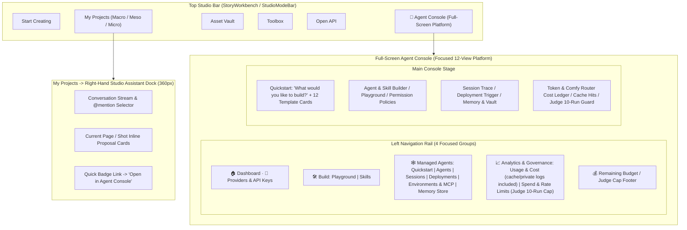

# SPEC_08: ZeroField Agent Console — Claude-Style Agent Build, Managed Orchestration, Analytics & Governance Platform (`SPEC_08_CLAUDE_CONSOLE_AGENT_PLATFORM.md`)

- **Status**: Lean implementation integrated; independent security/journey reviews pending. See [current usage](../SPEC08_CONSOLE.md) and [frozen verification](../spec08-verification.json). Engineering and deterministic journey evidence are not real semantic/model/billing acceptance.
- **Current scope authority**: Latest explicit user approval overrides stale enterprise/API/schema examples below: exactly `workspace=[dashboard,api_keys]`, `build=[playground,skills]`, `managed_agents=[quickstart,agents,sessions,deployments,environments,memory_store]`, `analytics=[usage_cost,spend_rate_limits]`. Retain all12 template IDs, blank/literal natural-language drafts, seven tools, versioned skills/scoped memory, bounded isolated grader, real existing M8 sessions/manual+cron, provider/environment controls, combined truthful analytics and active spend/rate/Judge limits. No new Files/Batches/IAM/service-account/webhook/OTel/retention or extra cache/log/CLI/integration surfaces/services. Preserve existing committed data/helpers without destructive pruning.
- **Prerequisite Baseline**: `SPEC_01` through `SPEC_07` (`eaf87f1` / `956536d`: 389 backend tests & 111 frontend tests passing; see [`docs/SPEC07_STUDIO_ROUTING.md`](../SPEC07_STUDIO_ROUTING.md) and [`docs/SPEC07_REVIEW.md`](../SPEC07_REVIEW.md))
- **Non-Negotiable `SPEC_07` Security & Routing Invariants to Preserve**:
  1. **Immutable `studio:*` Media Profiles**: Reserved internal M8 profiles (`studio:prepare`, `studio:open`, `studio:closed` in `project_assistant/story_media_adapter.py`) are computed and claimed exclusively by the in-process `_PRINCIPAL` object. `Agent Console` MUST display them as read-only system media executors (`runtime_kind: "server_media"`) and MUST NEVER allow users or API calls to edit, overwrite, or rebind `studio:*` profiles to remote workers.
  2. **Production Policy Ceiling & Privacy Lock**: Every project defaults to `open_weights_only`, bounded by the deployment ceiling `OPENBENCH_PRODUCTION_POLICY`. Neither Agent Console settings, Spend Limits, nor Studio Custom Tools (`studio_dispatch_shot`) may bypass `story.production_policy(conn, slug)`, `story.authorize_card()`, or numeric masking (`privacy_mode == "mask_numbers"` blocks commercial export).
  3. **Two-Step Allocation Contract (`story_allocation.py`)**: `studio_plan_allocation` previews `readiness_scope="configuration_and_inputs"` and produces an owner/episode/selection/source/policy-bound `allocationId` + `input_blockers`. `studio_dispatch_shot` must either require crew confirmation (`always_ask`) or consume a valid, unblocked `allocationId`, routing all media writes through M8 proposals/race gates—never bypassing guarded canvas writes.
  4. **Explicit Admin Authority for Runtime/CLI Changes**: Advisory recommendations (`recommend_agent_provider_tier`) and Quickstart templates never silently rewrite active credentials or spawn external CLI processes (`codex_cli` / `acp_stdio`) without explicit Showrunner (`me.can_edit`) persistence.
  5. **Official Comfy Developer Platform First-Class Alignment (`Comfy Router` + `Comfy API v2` + `Comfy SDK` + `Comfy MCP`)**:
     - Per the verified official contest submission form (`https://form.typeform.com/to/V1dSQrkS`) and `docs.comfy.org/development/comfy-router/`, `SPEC_08` adds first-class support for **`driver: "comfy_router"`** (`https://api.comfy.org/v2/models/{provider}/{model}/requests` and native **POST `/estimate`** pre-execution USD estimates using an allowlisted `COMFY_API_KEY` reference; official HTTP model routing does not require a graph SDK upgrade) covering the official contest models:
       - `ltx/ltx-2-5-pro` & `ltx/ltx-2-5-fast` (*VFX Workflow Built with LTX $2,000 Bonus*)
       - `bfl/flux-3-image` & `bfl/flux-3-video` (*Built with FLUX 3 Bonus*)
       - `minimax/minimax-h3` (*Built with MiniMax H3 Bonus* — native stereo audio MP4 + `first_frame` / `reference_image` / `base_video`)
       - `byteplus/dreamina-seedance-2-5-260628` & `higgsfield/higgsfield-genjutsu-motion-transfer-v1.0`
     - In `open_weights_only` mode (the default for the *Open Weights Only RTX 5090* track), critical-path execution stays 100% on open-weights models (`LTX-2.5` + `FLUX 3 Image Klein` + `line-worlds` via local ComfyUI / `comfy-api-proxy`). In `hybrid_studio` mode, `Comfy Router` and `Spend Limits` (including a **"Judge Live-Link 10-Run Cap"** preset matching the submission form's *"Expect 5-10 runs for judging purposes. Feel free to rate-limit or cap spending"* guidance) bound project generation admissions to10; they do not guarantee remote cancellation, real billing ceilings or provider charges. Default hard mode refuses official unlocked estimates, including `source=exact`; only explicit versioned current-admin `comfy_router_budget_mode=estimate_soft` consent permits estimate-risk admission. Task/body/quote fields cannot grant it. Actual reported overages remain accounted in full and provider reports are not invoices. See [verified protocol](../COMFY_ROUTER.md).
- **Owned Files**:
  - **Database Migration**:
    - `db/163_agent_console.sql` *(New: Skills, Memory Stores, Environments, Deployments, Usage/Cache/Cost Ledger, and Spend/Rate Limits with Judge 10-Run Cap)*
  - **Backend (`project_assistant/` & `project_docs/`)**:
    - `project_assistant/agent_console_store.py` *(New: CRUD & ledger queries for Agent Console resources)*
    - `project_assistant/agent_console_service.py` *(New: Quickstart templates, Playground runner, Deployments, Usage/Cost/Cache aggregations, Provider/Vault health, Spend & Rate Limit guardrails)*
    - `project_assistant/skills_registry.py` *(New: Built-in & custom versioned Skills including `shotgen`, `shotcheck`, `h3-context-ir`, `character-continuity`, `docx`, `xlsx`, `pdf`)*
    - `project_assistant/studio_tools.py` *(New: 6 Studio Custom Tools connecting agents to Story Workbench & ModelRouter + `consult_advisor` tool + `auto` / `always_ask` policy enforcement)*
    - `project_assistant/outcome_grader.py` *(New: Independent-context Outcome Grader & automatic self-revision loop before human `Needs You` review)*
    - `project_assistant/studio/model_router.py` *(Extend with official `comfy_router` driver for `https://api.comfy.org/v2/models/{provider}/{model}` and native `/estimate` pre-flight estimates (never a price lock))*
    - `project_assistant/agent_registry.py`, `project_assistant/tool_specs.py`, `project_assistant/tools.py` *(Extend with `skill_keys`, `tool_policies`, `multiagent_config`, `outcome_grader`, and upgraded cinema specialist prompts)*
    - `project_docs/http.py` / `project_docs/runtime_http.py` *(Mount `/projects/api/{slug}/agent-console/*` endpoints)*
  - **Frontend (`ui/src/`)**:
    - `ui/src/agentConsole/AgentConsoleApp.jsx` *(New: Full-screen Claude Console-style workspace with collapsible left navigation, `Ctrl+K` quick search, and spend/run-cap footer)*
    - `ui/src/agentConsole/ConsoleQuickstart.jsx` *(New: "What would you like to build?" natural-language builder + 12 production template cards with `Outcome-optimized` / `Recurring` / `Dynamic workflow` badges)*
    - `ui/src/agentConsole/ConsoleBuildViews.jsx` *(New: `Playground` & `Skills` views)*
    - `ui/src/agentConsole/ConsoleManagedViews.jsx` *(New: `Agents` builder form with `auto`/`always_ask` tool policies & Outcome Grader, `Sessions` trace inspector, `Deployments`, `Environments & Comfy MCP/CLI`, `Providers & Vault`, and `Memory Store` views)*
    - `ui/src/agentConsole/ConsoleAnalyticsAdminViews.jsx` *(New: combined `Usage & Cost` (including cache/fingerprints/private logs) and `Spend & Rate Limits (Judge 10-Run Cap)` views)*
    - `ui/src/agentConsole/agentConsole.css` *(New: High-contrast dark studio console styling matching the Claude Console layout)*
    - `ui/src/StoryWorkbenchModals.jsx`, `ui/src/App.jsx`, `ui/src/assistant/AssistantViews.jsx` *(Add top-level `Agent Console` entry; slim down the 360px right-hand `AssistantDock` to daily chat & active page proposals)*
    - `ui/src/i18n/locales/en.json`, `ui/src/i18n/locales/zh-TW.json`
  - **Tests**:
    - `tests/test_agent_console.py`
    - `ui/tests/agentConsole.test.mjs`

> **Scope Discipline (No Enterprise Bloat)**: Pure enterprise filler that adds zero filmmaking or contest value (**`OpenTelemetry`**, **`Data Retention`**, **`Service Accounts` IAM page**, **`Webhooks` admin table**, and duplicate **`Files` / `Batches`** tabs already covered by `Asset Vault` and `Cinema Studio`) is **explicitly excluded**. Every view in `Agent Console` must be 100% functional and directly serve AI filmmaking, provider/key management, usage analytics, or contest live-link protection.

---

## 1. Why & Architectural Goals

### 1.1 Why Separate the Agent Console from the Daily Production Dock?
1. **UI Cognitive Load & Space Constraints**:
   - The right-hand `Studio Assistant` drawer (`AssistantViews.jsx`, ~360px wide) inside `My Projects` is designed for **daily in-context collaboration** while viewing a script, storyboard table, or shot inspector (`SheetReview`).
   - Cramming **Agent construction (Prompts, Skills, MCP, Custom Tools, Outcome Graders)**, **Managed Orchestration (Sessions, Deployments, Environments, Memory Stores, Credential Vault)**, **Analytics (Usage, Cache hits, Rate limits, Cost ledger, Logs)**, and **active spend/rate/Judge governance within the combined analytics group** into a 360px drawer makes both daily filmmaking and agent administration cluttered and hard to manage.
2. **Claude Managed Agents Paradigm (`Workspace` × `Build` × `Managed Agents` × `Analytics`) **:
   - Following the Anthropic Claude Console architecture, ZeroField separates agent engineering and operations into a dedicated, full-screen **`Agent Console` (`AI 代理中控台`)** accessible from the top studio bar (`#/agent-console`), while keeping the right-hand `Studio Assistant` dock inside `My Projects` clean, fast, and focused on chatting, `@mention` routing, and reviewing inline page/shot proposals.
3. **Bridging Chat Agents to the `SPEC_06`/`SPEC_07` Cinema Engine**:
   - Previously, chat agents (`coordinator`, `doc_writer`, `sheet_ops`, `qa_critic`) had 1-line prompts and legacy document/table tools, unable to directly invoke `SPEC_06` Story Workbench actions or `SPEC_07` `ModelRouter` / `agent_allocator` pipelines.
   - `SPEC_08` equips agents with **versioned Cinema Skills (`shotgen`, `shotcheck`, `h3-context-ir`, `character-continuity`)**, **6 Studio Custom Tools** governed by per-tool **`auto` / `always_ask` permission policies**, **cross-session Memory Stores**, and an **independent Outcome Grader self-check loop**.

---

## 2. Full-Screen `Agent Console` UI & Navigation Architecture

### 2.1 Two-World Separation: Daily Production Dock vs. Full-Screen `Agent Console`



### 2.2 Complete Left Sidebar Specification (12 High-Impact Views — Zero Enterprise Fluff)

The left navigation rail of `AgentConsoleApp.jsx` preserves the clean Claude Console hierarchy while trimming out non-essential enterprise filler (`OpenTelemetry`, `Data Retention`, `Service Accounts`, `Webhooks`, and duplicate `Files`/`Batches`):

- **Header**:
  - Brand title: `ZeroField Console` + Sidebar collapse toggle button.
  - **Workspace / Production Switcher Dropdown** (e.g., `Default / Current Production`).
  - **Console Quick Search (`搜尋 Console...` / `Search Console...`, `Ctrl+K`)**: Instant filter jumping to any Agent, Skill, Session, Deployment, Environment, or Governance page.
- **Group 0 — Top-Level Shortcuts**:
  1. **`dashboard` (`儀表板` / `Dashboard`)**: Live KPI cards (Active Sessions, `Needs You` Gates/Reviews, Online Environments/Workers, 30-Day Token & Render Spend, Judge Live-Link Remaining Runs) + recent Session activity feed.
  2. **`api_keys` (`API 金鑰與供應商` / `Providers & API Keys`)**: Unified management of LLM Providers (`OpenAI`, `Claude`, `Gemini`, `Local Ollama`), **Comfy Developer Platform (`COMFY_API_KEY` for `Comfy Router` / `Comfy SDK`)**, and direct video adapters (`SEEDANCE_API_KEY`, `KLING_API_KEY`, `RUNNINGHUB_API_KEY`). Shows `OPENBENCH_AGENT_KEY_ENVS` allowlist status, connection health probe, and 1-click default provider switching without storing plaintext secrets in PostgreSQL.
- **Group 1 — `build` (`建構` / `Build`)**:
  3. **`playground` (`Playground`)**: Interactive testbench. Select any Agent or raw Model + Effort (`low`/`medium`/`high`) + System Prompt + attached Skills + Tools, run a live or dry-run request, and inspect structured output, tool call preview, and generated API code/payload.
  4. **`skills` (`Skills`)**: Versioned reusable instruction & workflow packages (`shotgen`, `shotcheck`, `h3-context-ir`, `character-continuity`, `docx`, `xlsx`, `pdf`, plus user-created custom skills).
- **Group 2 — `managed_agents` (`託管代理程式` / `Managed Agents`)**:
  5. **`quickstart` (`快速入門` / `Quickstart`)**:
     - Hero prompt box: **"What would you like to build?" (`您想建立什麼？`)** — enter natural language requirements to auto-draft an Agent + Skills + Workflow configuration, or pick from the **12 Production Quickstart Templates** below, or click **"Start from a blank agent" (`或從空白代理程式開始`)**.
  6. **`agents` (`代理程式` / `Agents`)**: Versioned Agent definitions (`coordinator`, `doc_writer`, `sheet_ops`, `qa_critic`, and custom agents; `studio:*` shown as read-only system media executors). Configure Model, Effort, System Prompt, mounted **Skills**, per-tool Permission Policies (**`auto` / `always_ask` / `disabled`**), Multi-Agent mode (`Subagents` / `Workflows` / `Advisor`), and **Outcome Grader** rubric. Supports Form View & Raw JSON View toggle.
  7. **`sessions` (`工作階段` / `Sessions`)**: Stateful execution sessions (`Orchestration Run` + conversation + tool trace + Outcome Grader iterations). Supports resuming, interrupting, answering open Decision Gates, or inspecting step-by-step traces.
  8. **`deployments` (`部署與排程` / `Deployments`)**: Binds `Agent + Environment + Initial Prompt/Playbook + Budget Cap` into a reusable deployment triggerable **manually (1-click)** or **on a recurring schedule (Cron + Timezone)**.
  9. **`environments` (`環境與橋接` / `Environments & Bridges`)**: Unified view of execution targets & Comfy Developer Platform integrations:
     - `env_local_4090` (**Local 4090 Sandbox**: local ComfyUI `127.0.0.1:8188` + **`comfy-api-proxy` `127.0.0.1:8189`** + FFmpeg)
     - `env_comfy_router` (**Comfy Router & Cloud**: `https://api.comfy.org/v2/models/{provider}/{model}` + `Comfy SDK` + **`Comfy MCP`** `https://cloud.comfy.org/mcp` / `comfy-mcp`)
     - `env_acp_local` (**CLI & ACP metadata only**, disabled by default; existing operator worker settings are preserved, no Console CLI launch or generic MCP execution)
  10. **`memory_store` (`記憶儲存區` / `Memory store`)**: Cross-session persistent memory stores (`style_rules`, `continuity_bible`, `retake_learnings`) with per-agent mount permissions (`read_only` / `read_write`), version history, and 1-click consolidation from recent retake notes.
- **Group 3 — `analytics` (`分析與護欄` / `Analytics & Governance`)**:
  11. **`usage_cost` (`用量與費用分析` / `Usage & Cost`)**: Combined dashboard showing input/output/cached tokens, image/video renders by Agent and Provider, SHA-256 fingerprint cache savings (`compute_request_fingerprint`), pre-flight native `Comfy Router /estimate` estimates (not price locks), and structured execution logs.
  12. **`spend_rate_limits` (`支出與速率護欄` / `Spend & Rate Limits`)**:
      - Configure per-agent concurrency (`max_concurrency`), RPM caps, and finite budget admission caps per Session, Episode, and Project (`pause` vs `downgrade_open_weights`, which requires a new explicitly reviewed open-weights allocation, never automatic rerouting). Router-only explicit estimate-soft mode is not a true billing cap.
      - Includes a 1-click **"Judge Live-Link Protection (10-Run Cap)"** toggle designed specifically for the contest submission's live trial URL (*"Expect roughly 5-10 runs total across the judging period. Feel free to rate-limit or cap spending"*).
- **Footer**:
  - **Remaining Budget / Judge Trial Runs Counter (`預算餘額 · 評審試玩剩餘次數`)** + Active Crew Identity badge.

---

### 2.3 Quickstart 12 Production Templates (`ConsoleQuickstart.jsx`)

The Quickstart page renders the 4×3 grid of 12 specialized templates matching the visual layout of Screenshot 1. Each card displays a title, 2-line description, integration/tool icons, and a capability badge (`🔍 Outcome-optimized` / `結果導向最佳化`, `🕒 Recurring` / `重複`, or `⑃ Dynamic workflow`):

| # | `template_key` | EN Title / ZH-TW Title | Badge | Pre-bound Agent, Skills & Tools |
| :-: | :--- | :--- | :--- | :--- |
| 1 | `script_breakdown_director` | **Script Breakdown Director**<br>劇本拆集與分鏡總編審 | `⑃ Dynamic workflow` | `coordinator` + `doc_writer` · Skills: `shotgen`, `character-continuity` · Tools: `studio_ingest_script`, `studio_manage_asset` |
| 2 | `continuity_frame_grader` | **Continuity & 8-Frame Grader**<br>連戲與 8 格時間戳審核官 | `🔍 Outcome-optimized` | `qa_critic` · Skills: `shotcheck`, `character-continuity` · Tools: `studio_inspect_frames`, `propose` |
| 3 | `hybrid_budget_dispatcher` | **Hybrid Compute Dispatcher**<br>開源 × 閉源混合算力調度師 | `⑃ Dynamic workflow` | `coordinator` · Skills: `shotgen` · Tools: `studio_plan_allocation`, `studio_dispatch_shot` |
| 4 | `h3_context_ir_compiler` | **H3-Context-IR Structured Compiler**<br>結構化六段式分鏡擷取工具 | `🔍 Outcome-optimized` | `sheet_ops` · Skills: `h3-context-ir`, `shotgen` · Tools: `read_page`, `propose_table_edit` |
| 5 | `openjutsu_motion_rig` | **OpenJutsu Motion Rig Director**<br>Line-Worlds 骨架與結構控制師 | `⑃ Dynamic workflow` | `sheet_ops` · Skills: `shotgen` · Tools: `studio_dispatch_shot`, `studio_inspect_frames` |
| 6 | `parallel_model_racer` | **Parallel Blind-Test Racer**<br>多模型並排競速盲測官 | `⑃ Dynamic workflow` | `coordinator` · Tools: `spawn_agent(strategy="race")`, `studio_dispatch_shot` |
| 7 | `offpeak_4090_batch_worker` | **Off-Peak 4090 Queue Runner**<br>夜間 4090 離峰佇列巡檢員 | `🕒 Recurring` | `sheet_ops` · Env: `env_local_4090` · Tools: `studio_plan_allocation`, `studio_dispatch_shot` |
| 8 | `twopass_4k_mastering` | **Two-Pass 4K Mastering Grader**<br>二階段母帶精修與幀數裁切師 | `🔍 Outcome-optimized` | `sheet_ops` + `qa_critic` · Skills: `shotcheck` · Tools: `studio_dispatch_shot` |
| 9 | `episode_rough_cut_assembler` | **Episode Rough-Cut Assembler**<br>整集粗剪合成與交接引導者 | `🕒 Recurring` | `coordinator` · Skills: `docx` · Tools: `studio_edit_timeline`, `offer_document` |
| 10 | `asset_vault_curator` | **Cast & Variant Vault Tracker**<br>角色服裝變體與資產守門員 | `🔍 Outcome-optimized` | `doc_writer` · Skills: `character-continuity` · Tools: `studio_manage_asset`, `search_pages` |
| 11 | `production_sheet_analyst` | **Production Slate & Formula Analyst**<br>製片試算表與數據分析師 | `🔍 Outcome-optimized` | `sheet_ops` · Skills: `xlsx` · Tools: `report_overview`, `report_sheet`, `propose_table_edit` |
| 12 | `comfy_card_integrator` | **Workflow & Card Integrator**<br>ComfyUI / RunningHub 轉卡工程師 | `⑃ Dynamic workflow` | `coordinator` · Tools: `list_pages`, `trigger_flow_run` |

---

## 3. Database Schema (`db/163_agent_console.sql`) & Model Contracts

The SQL sketches below preserve the original design intent, not an executable migration or API authority. The maintained non-destructive `db/163_agent_console.sql`, [execution envelope](../SPEC08_EXECUTION_ENVELOPE.md) and current service contract govern version/history/CAS, owner scopes, finite/nullable unknown money, immutable ledger, atomic reservations and strict effective Judge10. Inherited tables/helpers are not permission to expose excluded services; no schema/data pruning is authorized. Manual/cron are the supported deployment modes (not generic events). No setting can confer policy, scope, runtime or credential privilege.

### 3.1 Extending `projectops.agent_profile`
`db/163_agent_console.sql` non-destructively extends `projectops.agent_profile` (created in `158_agent_profiles.sql`) with the Claude-style build & governance fields:

```sql
ALTER TABLE projectops.agent_profile
  ADD COLUMN IF NOT EXISTS version INTEGER NOT NULL DEFAULT 1,
  ADD COLUMN IF NOT EXISTS effort TEXT NOT NULL DEFAULT 'medium' CHECK (effort IN ('low','medium','high')),
  ADD COLUMN IF NOT EXISTS skill_keys JSONB NOT NULL DEFAULT '[]',
  ADD COLUMN IF NOT EXISTS tool_policies JSONB NOT NULL DEFAULT '{}',
  ADD COLUMN IF NOT EXISTS multiagent_config JSONB NOT NULL DEFAULT '{"allow_subagents":false,"allow_workflows":false,"advisor_agent_key":null}',
  ADD COLUMN IF NOT EXISTS outcome_grader JSONB NOT NULL DEFAULT '{"enabled":false,"criteria":"","grader_agent_key":"qa_critic","max_revisions":1}',
  ADD COLUMN IF NOT EXISTS memory_mounts JSONB NOT NULL DEFAULT '[]',
  ADD COLUMN IF NOT EXISTS default_environment_key TEXT NOT NULL DEFAULT 'env_local_4090';
```

- **`tool_policies`**: Map of `tool_name -> "auto" | "always_ask" | "disabled"`.
  - When a tool is set to `"always_ask"`, calling that tool during an agent turn or session MUST NOT mutate state immediately; instead it creates a pending `ProposalCard` or opens a `Decision Gate` (`awaiting_gate`) requiring explicit crew confirmation.
- **`multiagent_config`**:
  - `allow_subagents` (`bool`): Permits `spawn_agent(strategy="single")`.
  - `allow_workflows` (`bool`): Permits multi-step DAGs, `strategy="race"`, and `strategy="fanout_rows"`.
  - `advisor_agent_key` (`str | null`): Permits calling `consult_advisor` to get a synchronous second opinion from another specialist (e.g., `sheet_ops` consulting `qa_critic` before submitting a shot prompt).
- **`outcome_grader`**:
  - `enabled` (`bool`), `criteria` (`str`), `grader_agent_key` (`str`, default `"qa_critic"`), `max_revisions` (`int`, 0..3).

### 3.2 New Agent Console Tables in `db/163_agent_console.sql`

```sql
-- 1. Versioned Skills Registry (Built-in + Custom per project)
CREATE TABLE IF NOT EXISTS projectops.agent_skill (
  project_slug TEXT NOT NULL REFERENCES projectops.project(slug) ON DELETE CASCADE,
  skill_key TEXT NOT NULL CHECK (skill_key ~ '^[a-z][a-z0-9_-]{0,63}$'),
  display_name TEXT NOT NULL,
  category TEXT NOT NULL DEFAULT 'cinema' CHECK (category IN ('cinema','document','data','custom')),
  version INTEGER NOT NULL DEFAULT 1,
  built_in BOOLEAN NOT NULL DEFAULT FALSE,
  enabled BOOLEAN NOT NULL DEFAULT TRUE,
  summary TEXT NOT NULL DEFAULT '',
  instructions_md TEXT NOT NULL DEFAULT '',
  recommended_tools JSONB NOT NULL DEFAULT '[]',
  updated_at TIMESTAMPTZ NOT NULL DEFAULT NOW(),
  PRIMARY KEY (project_slug, skill_key)
);

-- 2. Execution Environments (Local 4090 Sandbox, Hybrid Cloud Pool, Local ACP CLI)
CREATE TABLE IF NOT EXISTS projectops.agent_environment (
  project_slug TEXT NOT NULL REFERENCES projectops.project(slug) ON DELETE CASCADE,
  env_key TEXT NOT NULL CHECK (env_key ~ '^[a-z][a-z0-9_-]{0,63}$'),
  display_name TEXT NOT NULL,
  env_kind TEXT NOT NULL CHECK (env_kind IN ('local_sandbox','hybrid_cloud','acp_cli','remote_worker')),
  config JSONB NOT NULL DEFAULT '{}',
  network_access TEXT NOT NULL DEFAULT 'restricted' CHECK (network_access IN ('offline','restricted','allowlist','full')),
  allowed_hosts JSONB NOT NULL DEFAULT '[]',
  packages JSONB NOT NULL DEFAULT '[]',
  enabled BOOLEAN NOT NULL DEFAULT TRUE,
  updated_at TIMESTAMPTZ NOT NULL DEFAULT NOW(),
  PRIMARY KEY (project_slug, env_key)
);

-- 3. Persistent Cross-Session Memory Stores & Versioned Entries
CREATE TABLE IF NOT EXISTS projectops.agent_memory_store (
  project_slug TEXT NOT NULL REFERENCES projectops.project(slug) ON DELETE CASCADE,
  store_key TEXT NOT NULL CHECK (store_key ~ '^[a-z][a-z0-9_-]{0,63}$'),
  display_name TEXT NOT NULL,
  scope_kind TEXT NOT NULL DEFAULT 'project' CHECK (scope_kind IN ('project','episode','user')),
  description TEXT NOT NULL DEFAULT '',
  version INTEGER NOT NULL DEFAULT 1,
  updated_at TIMESTAMPTZ NOT NULL DEFAULT NOW(),
  PRIMARY KEY (project_slug, store_key)
);

CREATE TABLE IF NOT EXISTS projectops.agent_memory_entry (
  id UUID PRIMARY KEY,
  project_slug TEXT NOT NULL,
  store_key TEXT NOT NULL,
  entry_key TEXT NOT NULL,
  title TEXT NOT NULL,
  content_md TEXT NOT NULL,
  tags JSONB NOT NULL DEFAULT '[]',
  version INTEGER NOT NULL DEFAULT 1,
  updated_by TEXT NOT NULL DEFAULT 'system',
  updated_at TIMESTAMPTZ NOT NULL DEFAULT NOW(),
  FOREIGN KEY (project_slug, store_key) REFERENCES projectops.agent_memory_store(project_slug, store_key) ON DELETE CASCADE,
  UNIQUE (project_slug, store_key, entry_key)
);

-- 4. Managed Deployments (Manual 1-Click & Scheduled Cron Triggers)
CREATE TABLE IF NOT EXISTS projectops.agent_deployment (
  id UUID PRIMARY KEY,
  project_slug TEXT NOT NULL REFERENCES projectops.project(slug) ON DELETE CASCADE,
  deployment_key TEXT NOT NULL CHECK (deployment_key ~ '^[a-z][a-z0-9_-]{0,63}$'),
  display_name TEXT NOT NULL,
  agent_key TEXT NOT NULL,
  env_key TEXT NOT NULL DEFAULT 'env_local_4090',
  template_key TEXT,
  initial_prompt TEXT NOT NULL DEFAULT '',
  target_scope JSONB NOT NULL DEFAULT '{}',
  schedule_kind TEXT NOT NULL DEFAULT 'manual' CHECK (schedule_kind IN ('manual','cron','event')),
  cron_expr TEXT NOT NULL DEFAULT '',
  timezone TEXT NOT NULL DEFAULT 'Asia/Taipei',
  budget_cap_usd NUMERIC(10,2) NOT NULL DEFAULT 5.00,
  on_budget_exceeded TEXT NOT NULL DEFAULT 'downgrade_open_weights' CHECK (on_budget_exceeded IN ('pause','downgrade_open_weights')),
  enabled BOOLEAN NOT NULL DEFAULT TRUE,
  last_run_id UUID REFERENCES projectops.orchestration_run(id) ON DELETE SET NULL,
  last_run_at TIMESTAMPTZ,
  created_by UUID,
  updated_at TIMESTAMPTZ NOT NULL DEFAULT NOW(),
  UNIQUE (project_slug, deployment_key)
);

-- 5. Usage, Cache & Cost Ledger + Project Spend/Rate Limits (with Judge 10-Run Cap)
CREATE TABLE IF NOT EXISTS projectops.agent_usage_ledger (
  id BIGSERIAL PRIMARY KEY,
  project_slug TEXT NOT NULL REFERENCES projectops.project(slug) ON DELETE CASCADE,
  run_id UUID REFERENCES projectops.orchestration_run(id) ON DELETE SET NULL,
  agent_key TEXT NOT NULL,
  provider_name TEXT NOT NULL DEFAULT 'local',
  model_name TEXT NOT NULL DEFAULT 'default',
  usage_kind TEXT NOT NULL CHECK (usage_kind IN ('llm_turn','image_gen','video_gen','frame_prep','grader_check')),
  tier TEXT NOT NULL DEFAULT 'open_weights' CHECK (tier IN ('open_weights','closed_flagship','cloud_comfy')),
  input_tokens INTEGER NOT NULL DEFAULT 0,
  output_tokens INTEGER NOT NULL DEFAULT 0,
  cached_tokens INTEGER NOT NULL DEFAULT 0,
  cache_hit BOOLEAN NOT NULL DEFAULT FALSE,
  fingerprint TEXT,
  duration_ms INTEGER NOT NULL DEFAULT 0,
  estimated_cost_usd NUMERIC(10,4) NOT NULL DEFAULT 0.0000,
  estimated_saved_usd NUMERIC(10,4) NOT NULL DEFAULT 0.0000,
  meta JSONB NOT NULL DEFAULT '{}',
  created_at TIMESTAMPTZ NOT NULL DEFAULT NOW()
);

CREATE TABLE IF NOT EXISTS projectops.agent_console_settings (
  project_slug TEXT PRIMARY KEY REFERENCES projectops.project(slug) ON DELETE CASCADE,
  spend_limit_monthly_usd NUMERIC(10,2) NOT NULL DEFAULT 100.00,
  spend_limit_session_usd NUMERIC(10,2) NOT NULL DEFAULT 5.00,
  spend_limit_episode_usd NUMERIC(10,2) NOT NULL DEFAULT 15.00,
  judge_trial_cap_runs INTEGER NOT NULL DEFAULT 10 CHECK (judge_trial_cap_runs BETWEEN 1 AND 1000),
  judge_trial_used_runs INTEGER NOT NULL DEFAULT 0 CHECK (judge_trial_used_runs >= 0),
  judge_trial_mode BOOLEAN NOT NULL DEFAULT FALSE,
  on_spend_limit TEXT NOT NULL DEFAULT 'downgrade_open_weights' CHECK (on_spend_limit IN ('pause','downgrade_open_weights')),
  rate_limits JSONB NOT NULL DEFAULT '{"rpm_per_agent":30,"max_concurrent_renders":2,"max_concurrent_llm":4}',
  updated_at TIMESTAMPTZ NOT NULL DEFAULT NOW()
);
```

---

## 4. Built-in Skills, Studio Custom Tools & Outcome Grader

### 4.1 Seeded Built-in Skills (`project_assistant/skills_registry.py`)
Every project automatically seeds 7 built-in versioned skills (and allows users to create/upload custom Markdown skills in `Agent Console -> Build -> Skills`):
1. **`shotgen` (`Seedance / LTX Shot Command Compiler`)**: Converts narrative script beats into structured camera rig, lens focal length, motion trajectory, and `@CAST-01:variant` / `@SET-01` token bindings.
2. **`shotcheck` (`8-Frame Contact Sheet Continuity & Defect Diagnostic`)**: Guides vision/reasoning agents on reading `1600x600` 8-frame timestamped contact sheets (`VIDEO 1 / 0.312s ...`), diagnosing garment drift, extra limbs, temporal flicker, or timing overshoot, and prescribing targeted fixes.
3. **`h3-context-ir` (`MiniMax H3 6-Section Structured Prompt Compiler`)**: Formats prompts into `[ANCHOR]`, `[SUBJECTS]`, `[ENVIRONMENT]`, `[MOTION_TRAJECTORY]`, `[CAMERA_OPTICS]`, and `[CONTINUITY_CONSTRAINTS]`.
4. **`character-continuity` (`Soul Cast & Variant Continuity Guard`)**: Enforces strict adherence to `soul-cast` `@CAST-XX:variant` costume/prop rules and cross-shot screen direction.
5. **`docx` (`Production Brief & Handover Document Generator`)**: Formats executive production books and call sheets.
6. **`xlsx` (`Slate Formula & Budget Sheet Analyzer`)**: Audits sheet formulas, shot status distributions, and cost tables.
7. **`pdf` (`Script & Storyboard PDF Packet Inspector`)**: Extracts structured scene/dialogue blocks from imported reference documents.

When an agent executes a turn in `worker.py` or `agent_runtime.py`, its mounted `skill_keys` and mounted `memory_mounts` entries are compiled into a structured `<mounted_skills>` and `<production_memory_store>` system context block.

### 4.2 Studio Custom Tools (`project_assistant/studio_tools.py`)
To let agents actually operate the `SPEC_06` Story Workbench and `SPEC_07` `ModelRouter` / `agent_allocator` (both from the daily chat dock and from Managed Sessions), `tool_specs.py` and `tools.py` register 7 new tools:

| Tool Name | Default Permission Policy | Description & Underlying Engine Call |
| :--- | :---: | :--- |
| **`studio_ingest_script`** | `always_ask` | Parses script text into episode scenes, `@CAST` / `@SET` / `@PROP` assets (with costume `:variant` tags), and storyboard rows via `story_openapi` / `propose_table_edit`. |
| **`studio_manage_asset`** | `always_ask` | Creates or updates a character/set/prop asset or costume variant (`@CAST-01:night`) in `soul-cast`. |
| **`studio_plan_allocation`** | `auto` | Calls `story_allocation.plan_episode()` / `agent_allocator.plan_episode_allocation()` for the active episode and returns per-shot complexity (`b_roll`/`standard`/`hero`), assigned card/driver, and estimated cost without mutating tabs. |
| **`studio_dispatch_shot`** | `always_ask` *(or `auto` for local `open_weights` when configured)* | Dispatches single-shot or batch keyframe/video generation or 2-pass `@source` escalation through `story_media_adapter.enqueue()` / `ModelRouter`, respecting `production_policy` and `spend_limits`. |
| **`studio_inspect_frames`** | `auto` | Runs `media_prep.render_frame_sheet()` (`1600x600` 8-frame timestamped contact sheet) on a shot's source or candidate video (using SHA-256 fingerprint cache) and attaches the contact sheet + timing metadata to the agent's context. |
| **`studio_edit_timeline`** | `always_ask` | Splits a shot (`POST /shots/{id}/splits`), merges shots (`POST /shots:merge`), or triggers FFmpeg episode rough-cut export (`POST /episodes/{id}/films`). |
| **`consult_advisor`** | `auto` | **Claude Multi-Agent Mode 3 (Advisor)**: Allows an active agent (e.g., `sheet_ops`) to ask its configured `advisor_agent_key` (e.g., `qa_critic`) a focused question within the same session and receive a synchronous critique before finalizing its output. |

### 4.3 Outcome & Independent Grader Loop (`project_assistant/outcome_grader.py`)
When an Agent or Deployment has `outcome_grader.enabled == True`:
1. After the worker agent produces a candidate output or proposal, the platform does **not** immediately mark the task completed.
2. Instead, `outcome_grader.evaluate_outcome()` runs in an **isolated context** using `grader_agent_key` (default `qa_critic`), supplying only:
   - The original task objective,
   - The defined `outcome_grader.criteria` rubric,
   - The candidate output / proposal (and 8-frame contact sheet if a video was produced),
   - Mounted `memory_store` rules.
3. The Grader returns `{passed: bool, score: int (0..100), feedback: str, checklist: [...]}`:
   - Only `passed == True` permits candidate publication toward existing human review. Exhausted/invalid/unavailable grading remains failed **Needs You**, never approved completion; acknowledgment does not rerender or replay paid work.
   - If `passed == False` and `revision_attempt < max_revisions`, the Grader's `feedback` is fed back into the worker agent for an automatic revision pass, and the iteration is logged in `tools_trace` and `agent_usage_ledger`.

---

## 5. REST API Contract (`/projects/api/{slug}/agent-console/*`)

All endpoints require **current** `cp.actor(conn, slug, me)`. Agent/provider/environment/limit configuration requires existing `me.can_edit` admin; viewers cannot execute. Configuration/cancellation authority does **not** grant another owner's private chats/sessions/gates/traces/memory. Browser mutations retain same-origin/CSRF protection. Responses are plain JSON (not Story envelopes); unknown fields fail closed, version conflicts409 preserve drafts.

Current maintained route map (relative to the base above; full field mapping in [`ui/src/agentConsole/README.md`](../../ui/src/agentConsole/README.md)):

| Page / action | Actual service seam |
|---|---|
| Dashboard | `GET /dashboard`: owner recent activity, anonymous project aggregates, honest configured/heartbeat states |
| Quickstart | `GET /quickstart`; `POST /quickstart/draft {template_key?,requirements?}`: deterministic literal draft, never implicit save/launch |
| Agents | `GET /agents`; admin versioned save/history; computed `studio:*` is read-only `server_media` |
| Playground | `POST /playground {mode:dry_run\|live,objective,agent_key?...}`; raw live needs explicit versioned `save_and_run` and replay key; dry-run is not inference/sandbox proof |
| Skills | Versioned `/skills` and history; instruction Markdown cannot grant tools/privilege |
| Memory | Scoped `/memory-stores`, `/memory-entries`, history/archive; `/memory-stores/consolidate` consumes explicitly selected accessible reviewed evidence, not private chat harvesting |
| Sessions | Existing M8 `/sessions`, run-bound `/events?cursor&wait` long polling, owner `/resume` or `/resolve`, `/cancel` or `/interrupt`; no second scheduler or paid retry |
| Deployments | Versioned `/deployments` and `/{key}/trigger`; manual or five-field cron/IANA timezone, current-minute producer inside existing worker, no backfill |
| Providers | `/api-keys`, versioned `/providers`, `/api-keys/default`: allowlisted ENV references only, project-local inheritance by raw-empty built-in profiles; no global/profile rewrite |
| Environments | Versioned `/environments`; explicit admin `/connections/health` catalog/discovery only, never automatic paid probe; ACP metadata only |
| Usage & Cost | `/usage-cost?days=30`: anonymous project aggregates plus current-owner logs; estimates/reported prices/unknown/invoice remain distinct |
| Spend & Rate Limits | `/spend-rate-limits`: versioned lean fields only, explicit estimate-soft consent, strict effective Judge10, no writable used/reset counter |
| Router quote | `POST /sessions/{ownerRunId}/router-quotes` for exact native form or all-input-ready allocation; fresh native `/estimate`, no Judge debit; same frozen identity on generation |

No excluded service/tab is exposed merely because inherited storage exists. No plaintext secrets, credentials, signed URLs or raw provider errors in SQL/logs/examples. Quotes expire120s/process restart; source/credential/policy changes require explicit new review/quote. Missing/unknown/nonfinite estimates block; default hard refuses unlocked official charges. Soft consent is configuration, not execution authority. Per-outbound current/frozen tool/memory/advisor/grader/environment/credential/lease/deadline ceilings remain enforced; application controls are not an OS sandbox or hardware-cost guarantee.

---

## 6. Verification & Acceptance Criteria

1. **Full-Screen Console Isolation & 1:1 Navigation**:
   - Clicking **`Agent Console`** in the top studio bar (or navigating to `#/agent-console`) opens the full-screen `AgentConsoleApp` with exactly four navigation groups (`workspace`, `build`, `managed_agents`, `analytics`) and the12 exact IDs in section2.2, `Ctrl+K` quick search, and bottom budget meter.
   - The right-hand `Studio Assistant` drawer inside `My Projects` remains uncluttered for daily chat and current-page proposal review, with a quick button to jump to `Agent Console`.
2. **Quickstart 12 Templates & Blank Agent Flow**:
   - `Managed Agents -> Quickstart` renders the `"What would you like to build?"` prompt box, all 12 production template cards with their capability badges (`Outcome-optimized`, `Recurring`, `Dynamic workflow`), and the `"Start from a blank agent"` action.
3. **Skills, Tool Permission Policies (`auto` / `always_ask`), Memory Store & Outcome Grader**:
   - Mounting skills (`shotgen`, `shotcheck`, `h3-context-ir`, `character-continuity`) and memory stores (`style_rules`, `continuity_bible`) injects their versioned content into the agent prompt.
   - Calling a Studio tool configured as `always_ask` creates a reviewable proposal/gate rather than mutating production tabs directly.
   - Enabling `outcome_grader` runs the independent Grader evaluation and records the scorecard and any self-revision pass in the Session trace.
4. **Analytics, Vault Security & Spend Guardrails**:
   - Plaintext API keys are rejected by `validate_provider` / `/providers` (only env var names in `OPENBENCH_AGENT_KEY_ENVS` are accepted).
   - Exceeding `spend_limit_session_usd` or `spend_limit_episode_usd` blocks prohibited dispatch under the configured policy (`pause` or a new explicitly reviewed open-weights allocation). Local hardware cost remains unknown, not $0/free. Currency reservations include uncertain effects; current cancellation/deadline/environment checks remain mandatory. BatchN admitsN atomically before partial dispatch, replay counts once, operation11 is denied before outbound. Reads/previews/quotes/chat/grader/prep/cache without generation do not debit Judge.
5. **Bilingual & Regression Safety**:
   - All new UI labels exist in both `ui/src/i18n/locales/en.json` and `ui/src/i18n/locales/zh-TW.json`.
   - `python -m unittest discover -s tests -p "test_*.py"`, `npm test --prefix ui`, and `npm run build --prefix ui` pass with 0 failures and 0 skipped tests.
