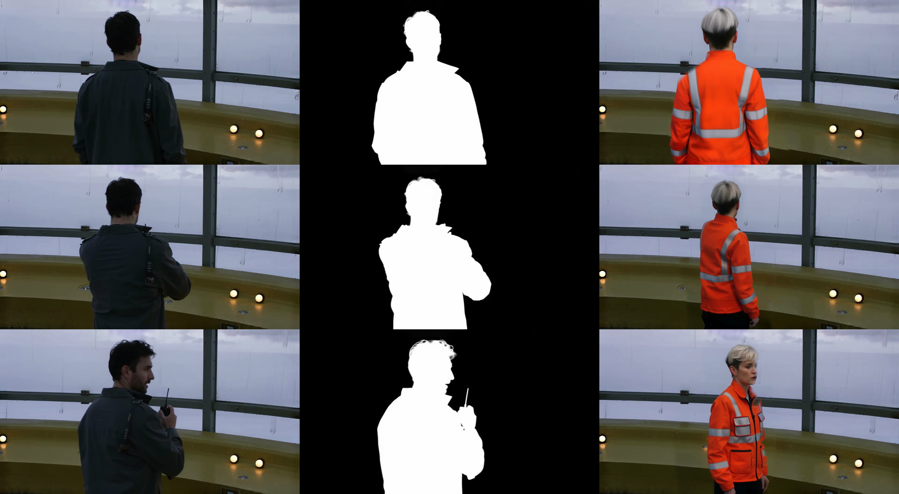
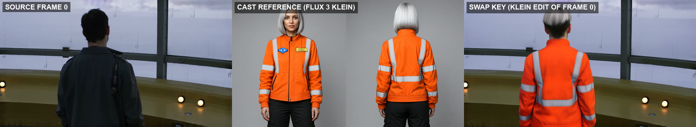
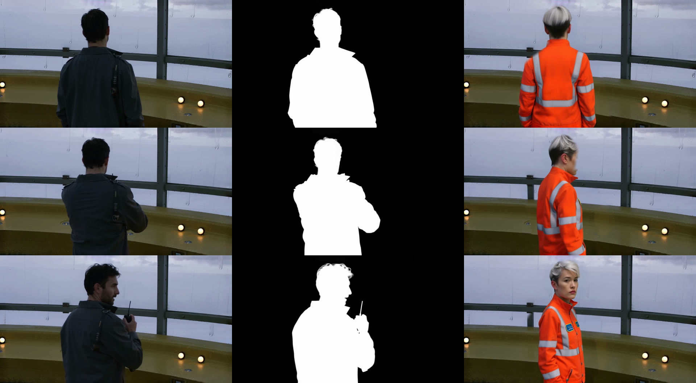
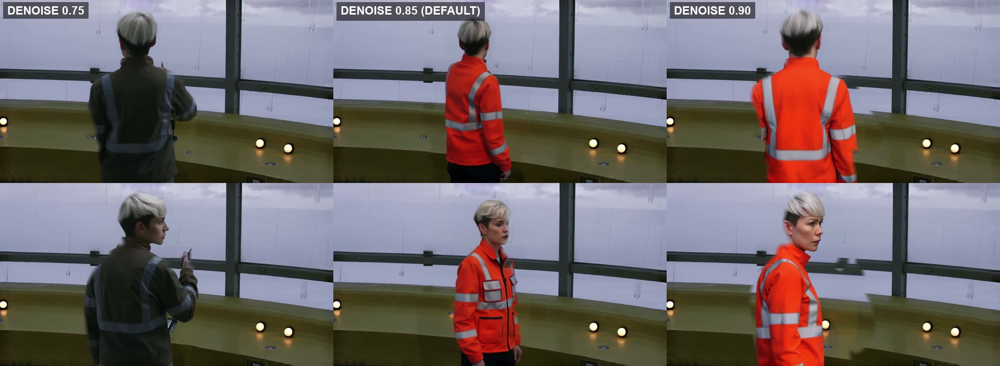

# OpenJutsu Object Swap: one RTX 4090 render

Date: 2026-10-21. Hardware: local RTX 4090, ComfyUI 0.42.1. This is one LTX-native subject replacement, run with [`workflows/ltx25_openjutsu_swap.json`](../../../workflows/ltx25_openjutsu_swap.json). It uses open weights only and needs no custom nodes beyond VideoHelperSuite's loader.

- [before_after.mp4](before_after.mp4): source on the left, swap on the right, source audio, 6 s.
- [workflow_executed.json](workflow_executed.json): the API prompt exactly as it was queued. Nodes 90–100 are lab-only debug outputs (matte and raw regeneration MP4s, plus lossless PNGs of frame 72). The product graph has none of them.
- [metrics.json](metrics.json): the pixel checks below.

## Inputs

| Input | Value |
| --- | --- |
| Source | *The Last Signal* Cinema Studio shot S02 (Kael at the observatory console, static 85 mm). 1280x704, 145 frames at 24 fps, with audio. |
| Replacement | An original character sheet made with FLUX 3 Klein (seed 7102): platinum silver bob and an orange high-visibility flight jacket. |
| Swap key | `flux3_klein_look_key.json` with frame 0 of the source (`23.batch_index` = 0) and the character sheet, seed 5502. This is the `swapkey` stage. |

## Settings (the `swap` stage defaults)

| Pass | Settings |
| --- | --- |
| Models | `ltx-2.5-22b-distilled-transformer-comfy-int8-convrot`, Gemma 4 12B int8 text encoder, LTX-2.5 video and audio VAEs |
| Matte | [Alpha-Gen IC-LoRA](https://huggingface.co/Lightricks/LTX-2.5-22b-IC-LoRA-Alpha-Gen) `ltx-2.5-22b-ic-lora-alpha-gen-0.9`: LoRA 1.0, source video as the IC-LoRA guide at strength 1.0, empty prompt, euler_ancestral, CFG 1, the official 8-step distilled sigmas `1.0 … 0.421875, 0.0` |
| Regeneration | Source latent at **denoise 0.85**, Klein key pinned on frame 0 (`LTXVImgToVideoInplace` 1.0), 8 steps euler/simple, CFG 1, seed 48291, prompt describing the new subject in the original action |
| Composite | `GrowMask` 20 px, `ImageBlur` radius 9 / sigma 4, `ThresholdMask` 0.02 × `MaskComposite` multiply, `ImageCompositeMasked` over the source loaded at native size, source audio kept |

Wall time: 290 s for the whole graph (matte, regeneration and composite), including model loads and queue time on a GPU shared with another session.

## Pixel checks

| Check | Result |
| --- | --- |
| Lossless frame 72 (PNG of composite vs PNG of the decoded source), where the final mask is 0 (72.5 % of the frame) | **100 % of pixels identical, max difference 0** |
| Same frame, where the mask is above 0 | 99.4 % of pixels changed |
| Output MP4 vs source, background (dilated matte under 2 %), mean abs difference | 1.487 / 255 |
| The source alone through the same ComfyUI load → save path, same region | 1.483 / 255 |
| Subject region, mean abs difference | 60.6 / 255 |

The background error in the MP4 matches a plain ComfyUI load → save round trip, so it is H.264 re-encoding, not the composite. Without the `ThresholdMask` gate, the decoded matte's faint VAE noise mixed up to 1/255 of regenerated pixels into 82 % of the "zero" background. It raised the MP4 background difference to 2.04 / 255.

## Through the Comfy SDK

The same graph also ran through the product stage on the Developer Platform path: `worker_configs(platform="comfy_sdk")["swap"]` → `card_engine.comfyui()` → comfy-sdk 0.5.0 → comfy-api-proxy 0.1.6 on `127.0.0.1:8189` → the same ComfyUI. The task was an OpenJutsu Lab row with **Jutsu Mode** `Object Swap`, the S02 clip as **Source Driving Video** and the Klein key as **Anchor Keyframe**. The stage's input bindings uploaded both files as SDK assets, and the prompt came from the row through the studio compiler. The job took 188 s and returned 145 frames at 1280x704 with the source audio. The background difference was 1.487 / 255, the same as the plain round trip. The prompt differs from the lab run, so the new subject differs too. See [sdk_run.json](sdk_run.json) for the stage config, compiled prompt and metrics.

## Denoise

At 0.75 the source jacket's colour wins after frame 0. At 0.90 the background inside the matte is regenerated too far from the source, and seams show at the railing and console. At 0.85 the identity holds on every frame and the background inside the matte stays continuous. The cost is motion fidelity: the source's radio is gone by the end, and the arm positions differ. Klein key seeds 5502/5503 and denoise 0.60/0.75/0.85/0.90 were tried. This page shows the 0.85 run.

## Known limits

- Alpha-Gen mattes the whole foreground. With several people it cannot select one; per-object selection (for example the core SAM3 nodes) is not wired.
- Alpha-Gen takes at most 145 frames, so the graph caps the source at 145.
- The Clean-Plate IC-LoRA is downloaded but not used. Inside the matte, the regeneration repaints the background where the new subject is smaller than the old one.
- The headline run used the lab driver (`zf.py` against ComfyUI's `/prompt`) so it could add the debug outputs; the SDK run above has none of them. Neither run went through the queued pipeline lane in the web app (Swap Key step, review, then OpenJutsu Swap). The lane and its row filter are covered by `tests/test_run_studio.py` and `ui/tests/studio.test.mjs`.
